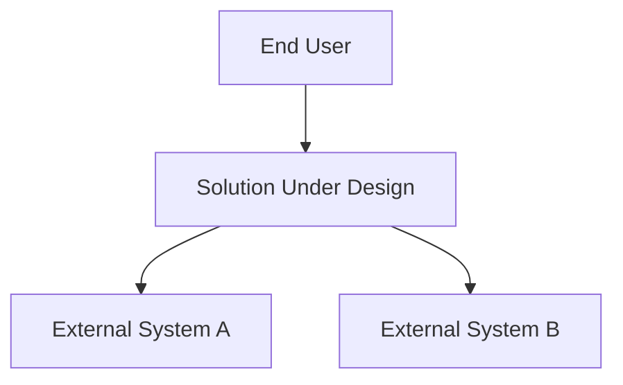
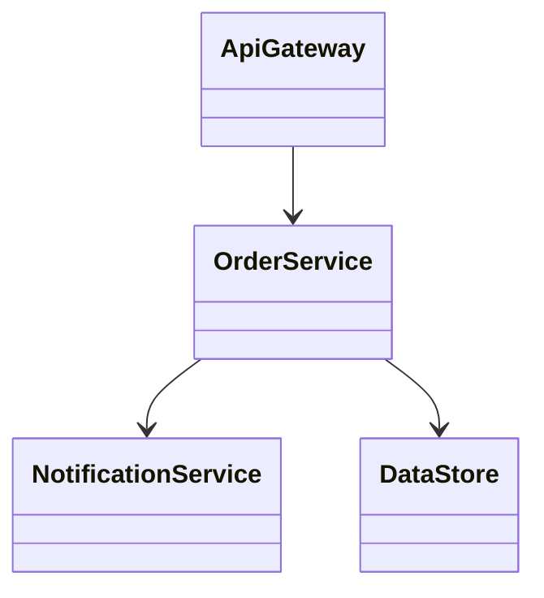
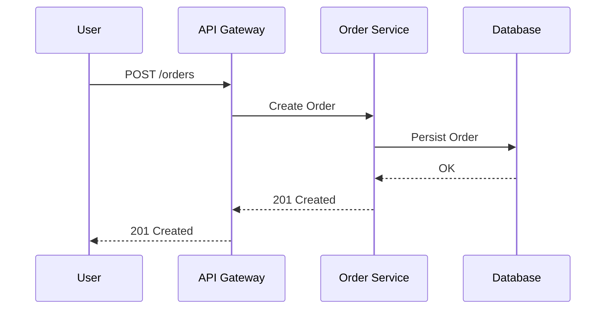
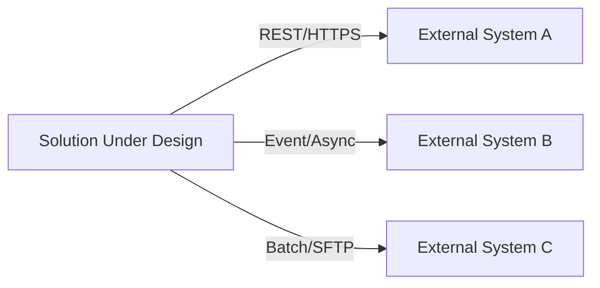
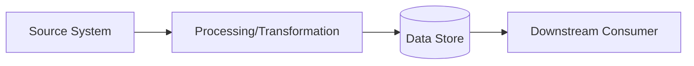
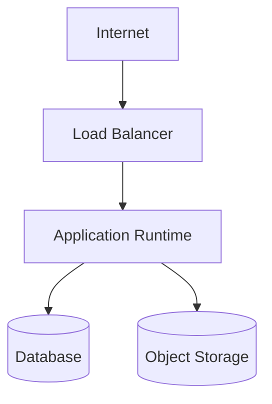
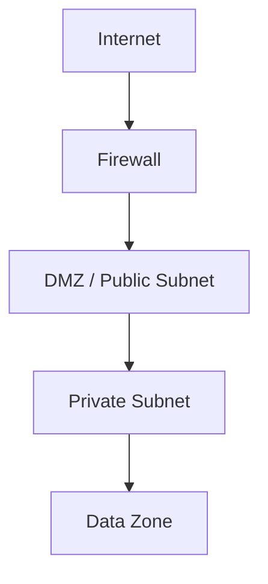
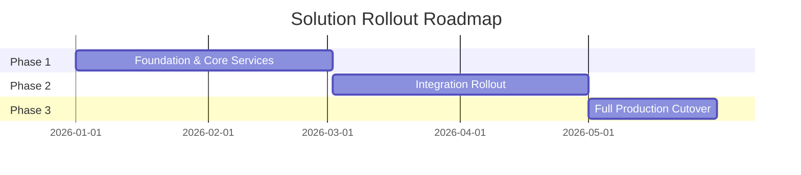

# Diagram Templates

Mermaid skeletons for every diagram type required across the Document Template. Adapt node names/labels to the project; keep the diagram type and overall shape. Diagram depth per Solution Scope Tier is defined in [Scope Tiers](./scope-tiers.md).

## Context Diagram

## Component Diagram

## Sequence Diagram

## Integration Diagram

## Data Flow Diagram

## Deployment Diagram

## Network Diagram

## Roadmap / Timeline Diagram

