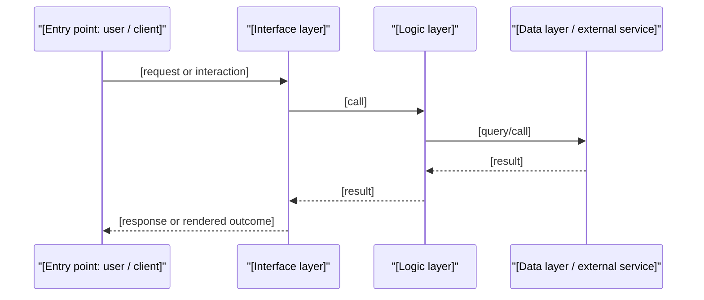

# Implementation Plan Template

Append this literal section to the end of the source story file. Use the same headings, order, and field names; do not rewrite any content outside this section. Fill stack-dependent fields from the selected stack profile(s) in `../references/stacks/`, and apply `../references/multi-stack.md` when more than one profile is in scope. Omit optional sections and strip every `<!-- -->` comment from the output. Copy only the content inside the outer four-backtick fence; it wraps nested Mermaid fences.

````markdown
## Implementation Plan

**Status:** Not Started <!-- Not Started | In Progress | Completed. Derived from subtask checkboxes: Not Started = none checked; Completed = all checked; otherwise In Progress. -->

### Scope & Dependencies

- Out of scope: [anything the story's Notes defer to other stories, units/layers not touched by this story, plus any part of the story this plan deliberately narrows]
- Prerequisites: [named prerequisite stories with their verified implementation-plan status, or "unknown — no sequence context"; do not assume they are complete]
- Contracts to preserve: [shared API contracts, schemas, events or cross-cutting requirements from prerequisite/downstream stories or other units that this plan must honor, or "None"]
- Design inputs: [repo-relative paths of the solution architecture/SAD, ADRs, OpenAPI specs, ERD, Mermaid or D2 diagrams, and wireframes used, each with what it settles (contract, components, data model, flow); or "None found in docs/"]
- Assumptions: [anything assumed rather than confirmed, and why; flag an unspecified primary user role here rather than inventing one]

### Discovery Summary
<!-- One block per in-scope unit. With a single unit, omit the unit name and role. -->

- Stack profile: [nextjs | springboot | generic] — [unit name] ([repo-relative path]) — [Provider | Consumer]
- Stack: [per the stack profile's Discovery fields]
- Data & auth: [per the stack profile, or "None present"]
- Tooling: [per the stack profile]
- Stack match: [Matches the [profile] baseline | Differs: [specifics] | Greenfield: [what is missing] | No profile — generic fallback ([discovered stack])]

### Files & Reuse Audit

| Item | Decision | Path | Purpose / rationale |
|------|----------|------|---------------------|
| [Component, class, module, migration, config, doc, or test file] | Reuse / Modify / Create / Delete | [Repo-relative path] | [Evidence-based reason or specific change, plus the details the stack profile's audit rule requires] |

### Technical Approach

- Data flow: [one line, or "see Integration Diagram"]
- API/schema changes: [...]
- API contract: [in the providing profile's contract format for each new/changed endpoint, action, or interface, complete enough for UI and backend to build against independently; cite the design input it adopts, or "defined here"; or "None — no API change"]
- Integration points: [external services, cross-unit calls, messaging, scheduled jobs, or "None"]
- Response & UI states: [how each endpoint/interface represents its outcomes and how each data-driven UI handles loading, empty, error and populated states, per the stack profile(s); or why none apply]
- Schema diagram: [None — no schema change in this feature | See ER diagram below]

```mermaid
erDiagram
    %% New/changed tables or models only; omit this block when no schema change applies (the "Schema diagram" line stays and says None).
```

### Integration Diagram
<!-- Include only when the data flow crosses 3+ architectural layers, involves an external/async call, or spans more than one unit. Use the participants named by the stack profile(s). -->



### Tasks

**Phase structure rationale:** [One or two sentences naming the stack profile(s) whose phase structure is used, confirming contract-first ordering (Data Contract first, build phases depending only on it, API Integration last) or why the Data Contract phase is omitted, and listing every task, subtask, or whole phase omitted, repeated, adapted, or composed across units, with the reason. Task numbers stay consecutive after omissions and repeats.]

**Implementation Checklist:**
<!-- Copy the phase and task templates from the selected stack profile's Checklist Template; compose per references/multi-stack.md for more than one profile. Tasks are vertical slices finished one at a time. -->

**Phase 1: Data Contract**
Depends on: None

**1. [Data Contract task from the stack profile]:**
- [ ] [Story-specific subtask from the template]

- **Exit gate:** `[commands]` → [every contract fixture conforms to its schema]
- **Gate result:** Not run

**Phase 2: [Build phase name from the stack profile]**
Depends on: Phase 1
<!-- Repeat per build phase (UI on contract fixtures, backend/provider). Build phases depend on the Data Contract phase, not on each other, unless the profile chains them. -->

**2. [Task name from the stack profile]:**
- [ ] [Story-specific subtask from the template]

- **Exit gate:** `[commands]` → [expected result, plus which ACs are now provable]
- **Gate result:** Not run

**Phase 3: API Integration**
Depends on: [every build phase, e.g. Phase 2]

**3. [Integration task from the stack profile]:**
- [ ] [Story-specific subtask from the template]

- **Exit gate:** `[commands]` → [expected result, plus confirmation that every AC has a passing scenario]
- **Gate result:** Not run

### Test Scenario Inventory

| ID | AC | Scenario | Type | Automation layer & file |
|----|----|----------|------|--------------------------|
| TC-01-[slug]-01 | AC-1 | per Test Cases | per Test Cases | [unit if multi-stack: resolved layer/tool and target test file] |
| TS-01 | AC-1 — [short restatement] | [scenario the story's Test Cases do not cover] | Edge | [unit if multi-stack: resolved layer/tool and target test file] |

_AC gaps: [None — every AC has at least one scenario and is covered by the subtasks | list any AC that is not, with the reason]_

`ID` is the source test-case ID for a scenario already in the story's `## Test Cases` section or the matching `docs/test-cases/` file (reference it, never copy its title, steps, expected result, or type), and a new `TS-nn` ID only for a scenario the plan adds. Without either source, every row is a `TS-nn` row with its own scenario text. `AC` uses the story's AC IDs, or `AC-1…AC-n` in source order when it has none (reuse the test cases' numbering if present); this column is the only place the plan defines those IDs. `Type` is one of Functional / Validation / Negative / Edge / End-to-End / Security / Performance, plus the types the stack profile(s) add (Accessibility, Reliability). Resolve `Manual / future automation target TBD` during planning by selecting the narrowest suitable layer the stack profile lists. Flag any scenario that is **end-to-end** by nature (a user action that must round-trip through the running application) — it needs a running app, not a unit-level check.

### Test Execution Approach

- **Focused test commands:** [commands for individual tests, grouped per unit when multi-stack; phase gate commands live in each Exit gate]
- **Test data / fixtures:** [per the stack profile: seed data, builders, auth state, mocks of true external boundaries, test database strategy]
- **Runtime requirements:** [everything that must be running: app servers, databases/containers, env vars, start order]
- [Design/responsive verification only when the stack profile calls for it and the story includes a design specification]

### Risks, Dependencies & Open Questions

- [Risk or dependency 1]
- [Rollout / rollback / backwards-compatibility / migration-safety note, when relevant]
- [Open question, or "None"]

### References

- [Relative path or link] — [Short description, e.g. source story, related story, test-case file, API spec, design spec, external API doc]
````
