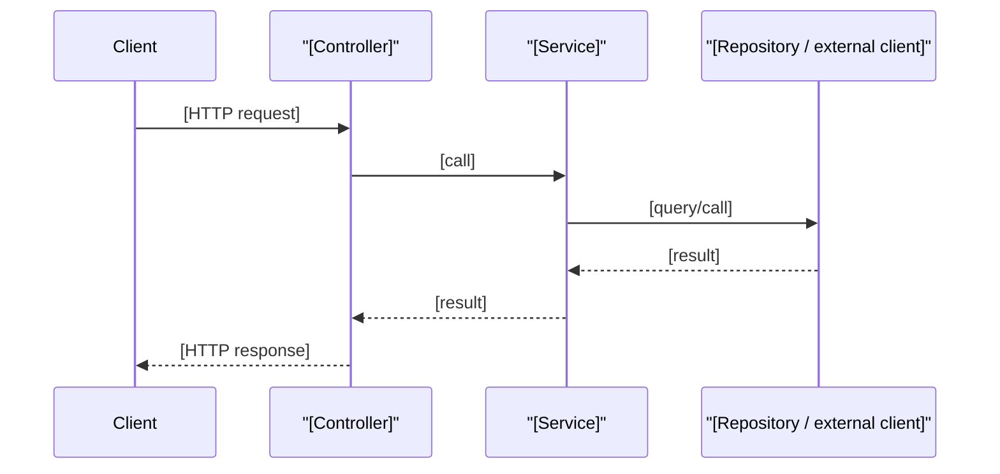

# Stack Profile: Spring Boot (Java backend)

Source: `nextjs/build-basic/prompts/be-create-implementation-plan.prompt.md`. Everything below the headings is copied verbatim from that prompt; read "this prompt" as this profile. "Requirement N" refers to the numbered Spring Boot requirements kept under **Requirements** below (or, when not listed, the same-numbered step of the shared procedure). Where this profile and the shared references differ, this profile wins for a Spring Boot unit; in a multi-stack plan, [multi-stack.md](../multi-stack.md) decides which unit owns UI work.

## Detection

Select this profile for a unit whose `pom.xml`/`build.gradle(.kts)` declares Spring Boot. Baseline and scope, from the prompt:

Turn an approved user story into **one** actionable, **task-based** backend implementation plan that covers both the feature work and its test automation, so a coding agent can execute any single task without re-deriving scope or design decisions. The plan's **structure** below is stack-agnostic; its **content** is filled in using this repo's actual backend stack (Java + Spring Boot, Spring Web, Spring Data JPA, Bean Validation, Spring Security, Flyway/Liquibase, JUnit 5/Mockito/AssertJ, MockMvc, Testcontainers — adapt if the repo's build files show otherwise).

- **Backend scope only**: plan the service, persistence, API, security and integration work the story needs. UI behavior implied by the AC is out of scope for this plan; record it under Out of scope and expose the API contract the UI will consume.

## Discovery

3. Discover this repo's actual backend stack: Java version, Spring Boot version, build tool and wrapper, multi-module layout, package structure (layered or feature-based), data access layer and migration tool, Spring Security setup, testing/static-analysis/coverage tooling, and configuration/secrets handling (`application*.yml`/`.properties`, profiles, env vars) — read `pom.xml`/`build.gradle(.kts)`, `settings.gradle`, and `src/main/resources` directly. Do not assume a stack; verify it.
4. Confirm this discovered stack matches the baseline (Spring Boot 3.x, Spring Web, Spring Data JPA, Bean Validation, Spring Security, Flyway or Liquibase, JUnit 5, Mockito, AssertJ, MockMvc, Testcontainers). Record the result in the Discovery Summary's **Stack match** field and treat it as the controlling gate for everything that follows: when it confirms a match, apply Core Conventions below as-is; when it notes a difference (for example WebFlux, MyBatis/jOOQ, Spring Boot 2.x, Kotlin), adapt those conventions to the repo's own and state each deviation inline. A library this plan needs that is not declared in the build file, or declared without its configuration (for example Testcontainers without a database module, Flyway without a migrations folder), counts as missing: record it under Differs, add one setup subtask for it to the first task, and note it under Risks. When the repository has no Java backend at all, record **Greenfield**, add a setup subtask to scaffold the Spring Boot module (Java version, build tool, base package, location) to the first task, and list every scaffolding decision not confirmed by the user or story under Open Questions.

Discovery Summary fields:

- Stack: [Java version, Spring Boot version, build tool (Maven/Gradle wrapper), and the affected module if multi-module]
- Data & auth: [database, ORM/data access, migration tool, and Spring Security mechanism (e.g. OAuth2 resource server/JWT, session), or "None present"]
- Tooling: [test libraries, static analysis/formatting (Checkstyle, Spotless, SpotBugs), coverage (JaCoCo), API docs (springdoc-openapi)]
- Stack match: [Matches this prompt's Spring Boot/JPA/JUnit/Testcontainers baseline | Differs: [specifics] | Greenfield: no backend module present]

## Plan Section Fields

Use these lines in place of the matching template placeholders.

**Plan Structure:**

- **Traceability** (AC → scenario → automation layer and test class) lives only in the Test Scenario Inventory.
- **Files** (create/modify/delete/reuse, including tests and migrations) live only in the Files & Reuse Audit.

**Scope & Dependencies:**

- Out of scope: [anything the story's Notes defer to other stories, UI work, plus any part of the story this plan deliberately narrows]
- Contracts to preserve: [shared API contracts, schemas, events or cross-cutting requirements from prerequisite/downstream stories that this plan must honor, or "None"]

**Files & Reuse Audit row:**

| Item | Decision | Path | Purpose / rationale |
|------|----------|------|---------------------|
| [Class, migration, config, doc, or test file] | Reuse / Modify / Create / Delete | [Repo-relative path] | [Evidence-based reason or specific change. For a new or modified class also state its layer (controller / service / repository / entity / DTO / mapper / config / client), its responsibility, and its transaction or security boundary where relevant.] |

**Technical Approach** (Response states fills the template's "Response & UI states" line):

- API contract: [OpenAPI-like contract for each new/changed endpoint — method, path, required authority/role, request DTO and validation constraints, response DTO, status codes, and error responses as RFC 9457 `ProblemDetail`; or "None — no API change"]
- Integration points: [external services, messaging, scheduled jobs, or "None"]
- Response states: [how each endpoint represents populated, empty, not-found, validation-error, unauthorized/forbidden, conflict and downstream-failure outcomes]

```mermaid
erDiagram
    %% New/changed tables only; omit this block when no schema change applies (the "Schema diagram" line stays and says None).
```

**Integration Diagram:**




**Tasks — Phase structure rationale:**

**Phase structure rationale:** [One or two sentences confirming the required contract-first three-phase structure and listing every task, subtask, or whole phase omitted, repeated, or adapted, with the reason (for example: no schema change, no external client, Liquibase instead of Flyway, one task per endpoint). Task numbers stay consecutive after omissions and repeats.]

**Test Scenario Inventory:**

| TC-01-[slug]-01 | AC-1 | per Test Cases | per Test Cases | [resolved layer/tool and target test class] |
| TS-01 | AC-1 — [short restatement] | [scenario the story's Test Cases do not cover] | Edge | [resolved layer/tool and target test class] |

`ID` is the story's own `TC-…` ID for a scenario already in `## Test Cases` (reference it, never copy its title, steps, expected result, or type) and a new `TS-nn` ID only for a scenario the plan adds. Without a `## Test Cases` section, every row is a `TS-nn` row with its own scenario text. `AC` uses the story's AC IDs, or `AC-1…AC-n` in source order when the story has none (reuse the numbering in `## Test Cases` if present); this column is the only place the plan defines those IDs. `Type` is one of Functional / Validation / Negative / Edge / End-to-End / Security / Performance / Reliability. Resolve `Manual / future automation target TBD` during planning: select the narrowest suitable unit, slice (`@WebMvcTest`, `@DataJpaTest`), integration (`@SpringBootTest`), or contract layer after discovery. Flag any scenario that is **end-to-end** by nature (an AC describing a user action that must round-trip through the running service and its database) — these need a running application context with real infrastructure, not just a unit-level check. Scenarios that only a UI can prove belong to the frontend plan; note them under AC gaps.

**Test Execution Approach:**

- **Focused test commands:** [commands for running individual test classes/methods; phase gate commands live in each phase's Exit gate]
- **Test data / fixtures:** [test data builders, SQL fixtures, `@WithMockUser`/JWT test tokens, WireMock stubs for true external boundaries, Testcontainers database strategy]
- **Runtime requirements:** [Docker for Testcontainers, required env vars or test profile, anything else that must be running]

**Risks and References:**

- [Rollout / rollback / backwards-compatibility / migration-safety note, when relevant]
- [Relative path or link] — [Short description, e.g. source story, related story, API spec, external API doc]

## Requirements

6. Fill Technical Approach (including the API contract) and the Tasks section using concrete patterns for this repo's stack (package layout, layer boundaries, data-layer changes, validation, security) — see the Core Conventions for the baseline, subject to the Stack match gate in step 4. Write the Tasks section per the skeleton, **Required Checklist Format**, and **Task Rules** below, which own the repeat, split, omit, renumber, and rationale rules.
8. Audit the actual codebase before completing the Files & Reuse Audit. Scope this audit to the feature's affected packages and their direct dependency graph (controllers, services, repositories, entities, DTOs, mappers, exception handlers, security and other configuration, migrations, and the tests that cover them) — not an unbounded codebase-wide sweep. Within that scope, add a row for each relevant existing item reused as-is or modified, and for each new item created, with its path and an evidence-based reason (for new items, why reuse is insufficient). Do not omit relevant in-scope items simply because they need no changes. Never propose a new class or test file without checking whether a suitable one already exists in scope. Resolve every conditional ("create if it doesn't exist", "if needed") during the audit; the final plan must not contain unresolved conditionals — decide, or list the question under Open Questions.
11. Append the plan using the literal skeleton to the end of the source story file under `## Implementation Plan`, with `Status: Not Started`, omitting optional sections that do not apply (the ER diagram block per Requirement 17 and the Integration Diagram per Requirement 18; optional tasks follow Required Checklist Format) and stripping all `<!-- -->` comments. Use the story's existing number and title; do not derive a new plan number or create a plan file. Preserve all existing story content, including `## Test Cases`, and do not modify content outside the appended plan section.
13. Derive package and test locations from the repository's actual structure and established conventions. Do not assume `com.example` or a layered `controller/service/repository` package split if the repo organizes by feature. Tests mirror the main package under `src/test/java`; migrations live where the migration tool is configured (default `src/main/resources/db/migration`). Paths for files that do not exist yet are proposals and must follow observed conventions.
14. In the Files & Reuse Audit, list every planned implementation, configuration, migration, documentation, and test file with a `Create`, `Modify`, or `Delete` decision and a short purpose. Use `Delete` only when removal is required. Do not list speculative files.
15. For new or modified classes, the audit row's rationale must give the layer, responsibility, and any transaction or security boundary. Never expose JPA entities directly as request or response bodies; plan DTOs instead.
16. Before writing, run the coverage check behind the inventory's `AC gaps` line: every AC maps to a scenario and a subtask, and every scenario maps back to an AC. Name actual test class paths in the `Automation layer & file` column and test commands in Test Execution Approach where repository conventions allow; do not invent test directories or files.
17. When this feature adds or changes a database schema, include the ER diagram and the Data Model task per the skeleton, and list `docs/erd.md` in the Files & Reuse Audit as `Create` or `Modify` after checking whether it exists. Migrations are new, versioned files; never plan edits to an already-applied migration. Otherwise set the Schema diagram line to "None — no schema change in this feature" and omit the ER diagram and Data Model task; never include a placeholder or unrelated-model diagram.
18. Include the Integration Diagram section only when the feature's data flow genuinely crosses 3+ architectural layers (e.g. controller → service → repository → database) or involves an external/async call (HTTP client, message broker, scheduler). A Mermaid sequence diagram naming the real participants and calls is sufficient — do not invent steps that don't occur. Omit the section entirely for simple, single-layer features rather than including a trivial diagram.
19. For every endpoint this feature introduces or modifies, the subtasks and the Technical Approach's Response states line must collectively account for its populated, empty (empty collection or page, not 404), not-found, validation-error, unauthorized/forbidden, conflict, and downstream-failure outcomes where applicable. If the feature exposes no endpoint, record that and why in Technical Approach.
20. Populate References with every file, document, API, or design link actually used while building this plan (the source story, related stories, an API spec, relevant existing code read during Discovery/Audit). Use "None" only if genuinely nothing beyond the story itself applies — do not fabricate links.

## Checklist Template

**Implementation Checklist:**
<!-- Tasks are vertical slices: finish one entity, service or endpoint completely (build, test, verify) before starting the next. Repeat the data model, service, endpoint and client task templates once per area, dependencies first, and renumber consecutively. -->

**Phase 1: Data Contract**
Depends on: None

**1. Data Contract:**
- [ ] Add required Spring Boot starters and test dependencies to `[pom.xml | build.gradle(.kts)]`
- [ ] Define request/response DTOs as Java records with Bean Validation constraints in `[repo-relative dto package path]`
- [ ] Define domain enums, value objects and exceptions in `[repo-relative domain package path]`
- [ ] Publish the `[EndpointName]` contract in the OpenAPI document at `[openapi spec path | springdoc-annotated controller interface]`, matching Technical Approach
- [ ] Create example JSON payloads for success, empty, validation-error (`ProblemDetail`), 401/403 and failure responses in `[repo-relative test resources path]`
- [ ] Write `@JsonTest` tests proving every example payload round-trips through its DTO and validates against the contract

- **Exit gate:** `[commands]` → [the OpenAPI document is published and every example payload conforms to its DTO]
- **Gate result:** Not run

**Phase 2: Domain, Persistence & Service Logic**
Depends on: Phase 1

**2. Data Model — [EntityName]:**
<!-- Include only when the feature adds or changes a database schema. Repeat per aggregate. -->
- [ ] Create migration `[repo-relative path]/V[n]__[description].sql` with tables, constraints and indexes
- [ ] Create/modify JPA entity `[EntityName]` in `[repo-relative entity path]`
- [ ] Create/modify `[EntityName]Repository` with the queries this story needs
- [ ] Write `@DataJpaTest` repository tests for `[EntityName]Repository` against Testcontainers `[database]`
- [ ] Update database ERD in `docs/erd.md`

**3. [ServiceName]:**
<!-- Repeat per service. -->
- [ ] Create `[ServiceName]` in `[repo-relative service path]` with its business rules
- [ ] Define `@Transactional` boundaries and read-only queries for `[ServiceName]`
- [ ] Map between entities and DTOs in `[MapperName]`
- [ ] Throw domain exceptions for `[not-found / conflict / rule-violation cases]`
- [ ] Write JUnit 5 + Mockito unit tests for `[ServiceName]` success, rule-violation and failure paths

**4. [ClientName] Client:**
<!-- Include only when the feature calls an external service. Repeat per external dependency. -->
- [ ] Create `[ClientName]` using `[RestClient | WebClient | Feign]` with externalized base URL and credentials
- [ ] Configure connect/read timeouts and retry/fallback behavior for `[ClientName]`
- [ ] Write WireMock tests for `[ClientName]` success, timeout and error responses

- **Exit gate:** `[commands]` → [expected result, plus any condition to confirm before the next phase starts]
- **Gate result:** Not run

**Phase 3: API Exposure & Integration**
Depends on: Phase 2

**5. [EndpointName]:**
<!-- Repeat this task for each new or changed endpoint. -->
- [ ] Create/modify `[ControllerName]` handler for `[METHOD] [path]` in `[repo-relative controller path]`
- [ ] Apply Bean Validation constraints with `@Valid` on the request DTO
- [ ] Enforce `[authority/role/ownership rule]` server-side in the security configuration or `@PreAuthorize`
- [ ] Map domain exceptions to `ProblemDetail` responses in `[GlobalExceptionHandler]`
- [ ] Write `@WebMvcTest` MockMvc tests for `[EndpointName]` success, validation, 401/403 and error responses, asserting bodies match the Phase 1 example payloads
- [ ] Verify the implemented endpoint matches the API contract in Technical Approach and the published OpenAPI document, and update the contract, document and example payloads together if it differs

**6. Integration Testing:**
- [ ] `@SpringBootTest` + Testcontainers test of `[user flow]` through HTTP, service and database

**7. Final Documentation & Polishing:**
- [ ] Add Javadoc to public service and controller methods
- [ ] Confirm the generated OpenAPI document matches the Phase 1 published contract
- [ ] Final review of integration
- [ ] Performance checks with realistic data (query count, pagination, indexes)

- **Exit gate:** `[commands]` → [expected result, plus confirmation that every AC has a passing scenario]
- **Gate result:** Not run

## Checklist Rules

- **Required output format — Implementation Checklist**: the checklist is always the contract-first three-phase `**Implementation Checklist:**` built from the task templates in Required Checklist Format, with templated tasks repeated per entity, service or endpoint and omitted where not applicable. That format takes precedence over any other rule in this prompt that would change its shape.

The Tasks section must reproduce the skeleton's `**Implementation Checklist:**` structure. These rules override any conflicting rule elsewhere in this prompt.

- **Phase 1: Data Contract** — one Data Contract task: DTOs, domain types, the published OpenAPI contract and example payloads, with no persistence, service or controller logic. Encode contracts from design inputs (OpenAPI spec, SAD API section) when they exist. Consumers (for example a frontend) can build against this contract without waiting for later phases.
- **Phase 2: Domain, Persistence & Service Logic** — task templates: one Data Model task per new or changed aggregate (only with a schema change), one `[ServiceName]` task per service, and one `[ClientName] Client` task per external dependency (only when the feature calls one). Each task carries its own tests, so an area is finished before the next one starts.
- **Phase 3: API Exposure & Integration** (always last) — task templates: one `[EndpointName]` task per new or changed endpoint (controller, validation, authorization, error mapping and its MockMvc tests), Integration Testing, and Final Documentation & Polishing.
- Keep the skeleton's task names, subtask wording, and order of templates as the baseline; replace bracketed placeholders (`EntityName`, `ServiceName`, `ClientName`, `EndpointName`) with this story's real names. Repeat a templated task once per area. Number tasks consecutively across the final list.
- If the story exposes no endpoint (for example a scheduled job or message consumer), replace the endpoint task with one task per job or consumer using the same shape (entry point, validation, error handling, tests), and keep Integration Testing and Final Documentation & Polishing. If the story has no persistence change, omit the Data Model task. Never leave an empty phase.
- Tests live inside the slice they verify: each data model task has its repository tests, each service task its unit tests, each client task its WireMock tests, and each endpoint task its MockMvc tests. The only test-only task is Integration Testing, which covers user flows across layers.
- Within Phase 3, order endpoint tasks so shared configuration (security rules, exception handler) is introduced by the first endpoint that needs it.

## Task Rules (Spring Boot wording)

- **A task is a focused context unit, finished before the next begins.** Each task is one vertical slice of one logical area (one aggregate, one service, one client, or one endpoint) that an agent can build, test and verify in a single session with only that area's context loaded. Do not group by layer across areas (for example all code, then all tests). Split a task when it spans several independent areas or would exceed about twelve subtasks; name splits `**N. Name — Area:**`. Do not split into single-subtask tasks, and do not merge unrelated areas into one task.
- **One outcome per subtask.** A subtask is a concise checkbox line with an action and a clear outcome: one observable behavior or one clearly bounded change, small enough to implement and verify in one focused AI-assisted session. Do not bundle independent outcomes just because they touch the same files or acceptance criterion, and do not split a coherent behavior into artificial code-versus-test subtasks; an area's tests belong in its own task.
- **Story-specific, not generic.** Each subtask names this story's entity, service, endpoint, rule, or behavior. Add subtasks to a task when an AC needs behavior the template subtasks do not cover (for example an additional business rule, state transition, or ownership check).
- **Order is the dependency model.** Tasks run in numbered order: Data Contract; then data models, services (a shared service before the one that uses it) and clients; then each endpoint; then Integration Testing; and cleanup and final review last. Put shared prerequisites before the subtasks that need them; do not add dependency IDs or parallelizable flags.

- Include focused tests in each area task, and flow tests in the Integration Testing task, that name the behavior they prove. Record concrete test classes in the Test Scenario Inventory and commands in Test Execution Approach or the phase Exit gate, not beneath subtask checkboxes.
- Include failure-path tests for security-relevant behavior (authentication, authorization, ownership, input validation).
- Each phase has one Exit gate, written with its `Gate result` after the phase's last task: the compile, static-analysis, test, migration-validation, and package commands that apply (for example `./mvnw verify` or `./gradlew check build`), plus a statement of which ACs are now provable. Phase 1's gate (contract published, payloads conform) runs before any implementation work begins; the last phase's gate also confirms every AC has a passing scenario.

- **Three phases, contract first.** Phase 1 (data contract), Phase 2 (domain, persistence and service logic) and Phase 3 (API exposure and integration) per the Required Checklist Format, each with a `Depends on` line. Each is a reviewable milestone: Phase 1 leaves a published contract with conforming example payloads; Phase 2 leaves tested business logic on a migrated schema; Phase 3 leaves the feature callable over HTTP end to end. Omit Phase 1 only when the story exposes no endpoint, message or other interface, and renumber. Every subtask sits under exactly one task, and every task under exactly one phase.

Across the subtasks and the plan's existing technical/test sections, make sure each applicable concern is covered: DTOs and contracts (records, Bean Validation, OpenAPI); data and schema (entity, migration, indexes); services (business rules, transactions); security (authentication, authorization, ownership); error handling (`ProblemDetail`); external clients (timeouts, retries); configuration (properties, profiles, secrets); tests.

## Quality Gate Specifics

Apply whichever of these are relevant to the feature; skip what doesn't apply. Call out any of these that the story's acceptance criteria doesn't already cover, so it isn't silently missed during implementation. When a gate yields a scenario, give it a `Type` of Security, Performance or Reliability and reflect the work in the relevant subtask checkbox and test scenario.

- **Security** (OWASP-aligned): authentication and authorization enforced server-side (URL rules and/or method security, including object-level ownership checks), Bean Validation on every request DTO, parameterized JPQL/Criteria queries (no string-concatenated SQL), mass-assignment prevention via DTOs, CSRF policy matching the session model, CORS allowlist, secrets kept out of `application*.yml` and logs, Actuator endpoints restricted, error responses without stack traces or internal detail, dependency vulnerabilities, rate limiting, and security event logging. Cite the concrete concern for this feature, not generic advice.
- **Testing**: unit/slice/integration coverage of happy paths, validation failures, authorization failures, edge cases, and regressions of the specific behavior being changed.
- **Performance**: N+1 queries and fetch strategy, pagination for collections, indexes for new query predicates, connection-pool and transaction duration, caching/invalidation — justify optimizations with evidence, not speculation.
- **Reliability**: timeouts, retries and fallbacks for external calls, idempotency for retried operations, optimistic locking (`@Version`) for concurrent updates, backwards-compatible (expand/contract) migrations, rollout/rollback, and feature flags where the change warrants them.
- **Observability**: structured logging without PII or secrets, correlation IDs, and metrics/health indicators for new external dependencies, when the feature adds them.

## Core Conventions

**Apply only when Stack match confirms this baseline (Requirement 4); otherwise use the repo's own conventions and state each deviation inline.** If the repository has a Java/Spring instructions file under `.github/instructions/`, read it during Discovery and plan work that satisfies it; do not restate it in the plan. The points below are planning-specific:

- **Greenfield package shape** (the repo's own layout wins when it differs): `[basePackage].[feature].api` controllers and request/response records, `[basePackage].[feature].service` services, `[basePackage].[feature].domain` entities and repositories, `[basePackage].common` exception handling and shared config, `[basePackage].config` security and infrastructure configuration; migrations under `src/main/resources/db/migration`.
- **Layer rules**: controllers are thin (validate, delegate, map status codes); business rules and `@Transactional` boundaries live in services; repositories hold only data access; entities never cross the API boundary; constructor injection only.
- **Version-sensitive behavior**: check the discovered Spring Boot and Java versions for behavior that varies (`jakarta.*` vs `javax.*`, `SecurityFilterChain` lambda DSL, `RestClient` availability, virtual threads, `ProblemDetail` support, `@MockitoBean` vs `@MockBean`) before planning around it.
- **Test layers**: pure business rules → JUnit 5 + Mockito unit tests; HTTP contract, validation and security rules → `@WebMvcTest` with MockMvc and `spring-security-test`; queries and mappings → `@DataJpaTest` against Testcontainers (not H2, unless the repo already standardizes on it); external HTTP → WireMock; full flows → `@SpringBootTest` with Testcontainers. Add at least one real-database integration scenario when a subtask changes persistence.
- **Coverage expectations for the Test Scenario Inventory**: every new endpoint gets a success, a validation-error and an unauthorized/forbidden scenario; every new business rule gets a pass and a violation scenario; every new user-facing flow gets one integration scenario.

## Re-run Notes

- also check whether repository facts the plan relied on have changed (stack, package layout, existing classes), not only the AC
- if the existing plan targets a different stack (for example a Next.js plan) and the user asks for a Spring Boot backend plan, treat it as a feedback case: rewrite the section in this format, keep stack-independent content (scope, assumptions, AC numbering, scenarios, open questions), and drop or move frontend-only work to Out of scope

## Hard Rules

- Never invent technical detail that isn't grounded in either the actual repo (Discovery/Audit) or this prompt's documented stack conventions.
- Never plan frontend code in this prompt; expose the API contract and leave UI work to a frontend plan.
