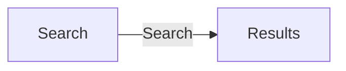

# Output format

Two files, two audiences. Same journey and step IDs in both.

| File | Reader | Contains |
|---|---|---|
| `docs/exploration/<app>/journeys.md` | Product, BA, business, testers, new joiners | What the app must do, in plain language. No code. |
| `docs/exploration/<app>/journeys-trace.md` | Developers, architects, verifiers | Per-step component, API, data, logic and evidence. |

Write `journeys-trace.md` first (it is the evidence), then derive
`journeys.md` from it. Split per journey when there are more than ~6.

## journeys.md — plain-language rules

The test: someone who has never seen the code or the screens can read it
in five minutes and explain what the app does and what it must keep doing.

- **No code.** No file names, class names, URLs, HTTP methods, field
  names, table names, status codes, framework terms, `FE`/`BE` tags or
  evidence citations. Use the words on the screen or from the transcript.
- **One idea per line.** Steps ≤ 15 words. Write "Staff enter a mobile
  number or an email", not "Enters msisdn or email, optionally ticks…".
- **Say what, not how.** "The app checks the staff member is allowed to
  view profiles", not "AuthFilter checks role PROFILE_VIEWER".
- **Rules as "must" statements**, with the concrete value: "A mobile
  number must be 8 digits and start with 8 or 9."
- **Background behaviour in one plain line** when it matters to the
  business: "Every search is recorded with the staff member's ID."
- **Quirks and suspected bugs are not steps.** Put them in *Things to
  confirm* as a business question.
- **Status words only where doubt exists**: add "(to confirm)" to a line;
  otherwise say nothing.
- Keep diagrams to screens and user actions; ≤ 10 nodes.

### Template

````markdown
# <App name> — how it works

## What the app is for
2-4 sentences. Who uses it, what they get done, what it depends on.

## Who uses it
| Who | What they can do |
|---|---|
| <persona> | <plain list of capabilities> |

## What the app must do
Numbered capabilities, one line each, each pointing to a journey.
1. Let staff find a customer by mobile number or email. (J1)
2. ...

## Screens at a glance


## J1 · <journey name in business words>
**Who:** <persona> · **Goal:** <outcome in one line>
**Before starting:** <what must already be true>

1. <User does X.> → <App does / shows Y.>
2. ...

**Rules**
- <"must" statement with the concrete value>

**If something goes wrong**
| Situation | What the user sees | What happens next |
|---|---|---|

## Things to confirm
| # | Question (business words) | Why it matters | Ask |
|---|---|---|---|
````

## journeys-trace.md — technical template

````markdown
# Journey trace — <app>
Sources: <code paths> · <transcript> · <screenshots> · <test cases>
Scope: <whole app | feature name>

## Identity and personas
| ID | Claim | Evidence | Status |
|---|---|---|---|

## J1 · <same name as journeys.md>
| # | User action | Application component | API | Data exchanged | Logic performed | Evidence | Status |
|---|---|---|---|---|---|---|---|

Exits
| From step | Exit | Trigger | User sees | Goes to | Evidence |
|---|---|---|---|---|---|

## Orphans
Screens/endpoints no journey reached; source steps with no code found.

## Open questions (technical detail)
| ID | Question | Evidence | Maps to "Things to confirm" # |
|---|---|---|---|
````

## Trace cell conventions

- **User action**: verb-first, business words from the transcript vocabulary.
- **Application component**: screen + handler/component names, backticked;
  prefix the `UI-` ID when `ui.md` exists.
- **API**: method + path, or `form post → <target>`, or `—` for client-only;
  prefix the `API-` ID when `api.md` exists.
- **Data exchanged**: `in:` request fields, `out:` response/screen data,
  `state:` anything carried to later steps.
- **Logic performed**: one clause per rule, tagged `FE`, `BE`, `FE+BE`,
  `SEC`, `DATA`, `ASYNC`.
- **Status**: `Confirmed`, `Inferred` or `Open`.
