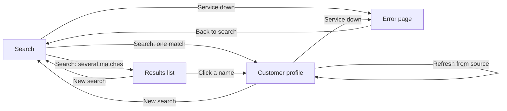

# Customer Profile Lookup — how it works

## What the app is for

Customer service staff use this app to find a customer and read their
profile. They search by mobile number or email, then open the customer's
details. The app does not hold customer data itself: it asks a central
profile service each time. Every search and every profile view is recorded
against the staff member who did it.

## Who uses it

| Who | What they can do |
|---|---|
| Profile viewer (staff) | Search for customers, open a profile, refresh it. Sees the NRIC partly hidden. |
| Profile admin (staff) | Everything a viewer can do, and sees the full NRIC. |
| Staff without profile access | Nothing. They are turned away. |

## What the app must do

1. Only let signed-in staff with profile access use the app. (J4)
2. Let staff find a customer by mobile number **or** email. (J1)
3. Open the profile straight away when there is exactly one match. (J1)
4. Show a list when there are several matches, up to 20. (J1)
5. Show a customer's details: name, mobile, email, NRIC, date of birth and age, segment, status. (J2)
6. Hide most of the NRIC unless the staff member is an admin. (J2)
7. Flag VIP and senior customers. (J2)
8. Let staff reload a profile with the latest data from the source. (J3)
9. Record who searched for whom and who viewed which profile. (J1, J2)

## Screens at a glance

## J1 · Find a customer

**Who:** Viewer or admin · **Goal:** open the right customer's profile
**Before starting:** signed in with profile access (J4).

1. Staff open the app. → The search screen appears, showing who is signed in.
2. Staff enter a mobile number or an email. → The app checks the input.
3. Staff can tick "Include inactive profiles". → Inactive customers will be included.
4. Staff click Search. → The app asks the profile service for matches.
5. One match → the customer's profile opens (J2).
6. Several matches → a list shows name, partly hidden mobile, email and status.
7. Staff click a name. → That customer's profile opens (J2).

**Rules**
- Staff must enter a mobile number or an email, not both.
- A mobile number must be 8 digits and start with 8 or 9.
- An email must be a valid address of at most 80 characters.
- Inactive customers are left out unless "Include inactive profiles" is ticked.
- At most 20 results are shown; past that, staff are asked to refine the search.
- In the results list, only the first 4 digits of the mobile are shown.
- Every search is recorded with the staff member's ID.

**If something goes wrong**

| Situation | What the user sees | What happens next |
|---|---|---|
| Nothing entered | "Enter a mobile number or an email." | Stays on search |
| Both entered | "Search by mobile number or email, not both." | Stays on search |
| Mobile or email in the wrong format | A message naming the field | Stays on search |
| No customer matches | "No matching profiles." | Stays on search |
| 20 or more matches | "Showing the first 20 matches. Refine your search." | List still shown |
| Profile service unavailable | "The profile service is unavailable. Please try again later." | Error page with a link back to search |

## J2 · View a customer's profile

**Who:** Viewer or admin · **Goal:** read a customer's details
**Before starting:** a customer was picked in J1.

1. The profile opens. → The app shows the customer's details.
2. Staff read name, user ID, mobile, email, NRIC, date of birth and age, segment and status.

**Rules**
- Viewers see the NRIC with all but the first character and last 4 hidden.
- Admins see the full NRIC.
- Gold and Platinum customers are marked "VIP".
- Other customers aged 65 or over are marked "Senior".
- Each profile view is recorded with the staff member's ID.
- Once loaded, a profile is reused for all staff until someone refreshes it.

**If something goes wrong**

| Situation | What the user sees | What happens next |
|---|---|---|
| Customer no longer exists | "No profile found for user …" | Back on the search screen |
| Profile service unavailable | "The profile service is unavailable. Please try again later." | Error page with a link back to search |

## J3 · Refresh a profile

**Who:** Viewer or admin · **Goal:** see the latest data for a customer
**Before starting:** a profile is on screen (J2).

1. Staff click "Refresh from source". → The app drops its saved copy.
2. The app fetches the profile again from the profile service. → The fresh profile is shown.

**Rules**
- A refresh updates the profile for every staff member, not just the one who clicked.
- The refreshed view is recorded like any other profile view.

**If something goes wrong:** same as J2.

## J4 · Get into the app

**Who:** Any staff member · **Goal:** reach the app's screens
**Before starting:** none.

1. Staff open any page of the app. → The app checks they are signed in.
2. Not signed in, or idle for over 20 minutes. → They are sent to the sign-in page.
3. Signed in but without profile access. → They are refused.
4. Signed in with viewer or admin access. → The requested screen opens.

**Rules**
- Only staff with the profile viewer or profile admin role can use the app.
- Sessions end after 20 minutes of inactivity.
- Sign-in itself happens outside this app (to confirm).

## Things to confirm

| # | Question | Why it matters | Ask |
|---|---|---|---|
| 1 | Which system signs staff in and gives them their profile role? | Sign-in is not part of this app; the new app must connect to it. | Ops, dev |
| 2 | When staff search by email, should the email be recorded in the audit trail? Today it appears to be left blank. | The audit trail may be missing who was searched for. | Product, dev |
| 3 | Should the "first 20 matches" message show when there are exactly 20 matches? | Today it does, which suggests more results exist when they may not. | Product |
| 4 | Is it acceptable that profiles stay out of date for everyone until someone presses Refresh? | Staff may act on stale customer data. | Product, ops |
| 5 | Are these the right visibility rules: mobile partly hidden in the list but full on the profile, NRIC hidden for viewers only, email never hidden? | Personal data exposure. | Product, security |
| 6 | Should the error page ever show technical details to staff? | Possible information leak. | Dev |
