# Diagram Patterns

One canonical pattern per diagram type. Match intent → select type → apply pattern.

## Table of contents

- [Pattern 1 - Flowchart: Layered Architecture (TB)](#pattern-1--flowchart-layered-architecture-tb)
- [Pattern 2 - Flowchart: Flat Dependency / Component Graph (LR)](#pattern-2--flowchart-flat-dependency--component-graph-lr)
- [Pattern 3 - Flowchart: Decision Tree / Algorithm (TD)](#pattern-3--flowchart-decision-tree--algorithm-td)
- [Pattern 4 - Sequence Diagram](#pattern-4--sequence-diagram)
- [Pattern 5 - State Diagram](#pattern-5--state-diagram)
- [Pattern 6 - Entity-Relationship Diagram](#pattern-6--entity-relationship-diagram)
- [Pattern 7 - Class Diagram](#pattern-7--class-diagram)
- [Pattern 8 - C4 Context Diagram](#pattern-8--c4-context-diagram)
- [Pattern 9 - User Journey](#pattern-9--user-journey)
- [Pattern 10 - Gantt Chart](#pattern-10--gantt-chart)
- [Pattern 11 - Mindmap](#pattern-11--mindmap)
- [Pattern 12 - Timeline](#pattern-12--timeline)
- [Pattern 13 - Git Graph](#pattern-13--git-graph)
- [Pattern 14 - Sankey Diagram](#pattern-14--sankey-diagram)
- [Pattern 15 - Quadrant Chart](#pattern-15--quadrant-chart)
- [Pattern 16 - Pie Chart](#pattern-16--pie-chart)
- [Pattern 17 - Requirement Diagram](#pattern-17--requirement-diagram)
- [Pattern 18 - XY Chart](#pattern-18--xy-chart)
- [Pattern 19 - Block Diagram](#pattern-19--block-diagram)
- [Pattern 20 - Kanban Board](#pattern-20--kanban-board)
- [Pattern 21 - Architecture Diagram](#pattern-21--architecture-diagram)
- [Pattern 22 - Radar Chart](#pattern-22--radar-chart)
- [Pattern 23 - Treemap](#pattern-23--treemap)
- [Pattern 24 - Packet Diagram](#pattern-24--packet-diagram)
- [Verification checklist (all types)](#verification-checklist-all-types)

For niche/very recent types (Venn, Ishikawa, Wardley Map, Cynefin, Swimlane, Tree View,
Event Modeling, Railroad, ZenUML) and the two not-yet-released types (Agent Flow, Use
Case), see `references/emerging-diagram-types.md`. Before drafting any pattern
introduced in the last few Mermaid releases, check
`references/mermaid-version-compatibility.md` for renderer support.

---

## Pattern 1 — Flowchart: Layered Architecture (TB)

**Use when:** components arranged in horizontal tiers; flow mostly crosses layers top-to-bottom.

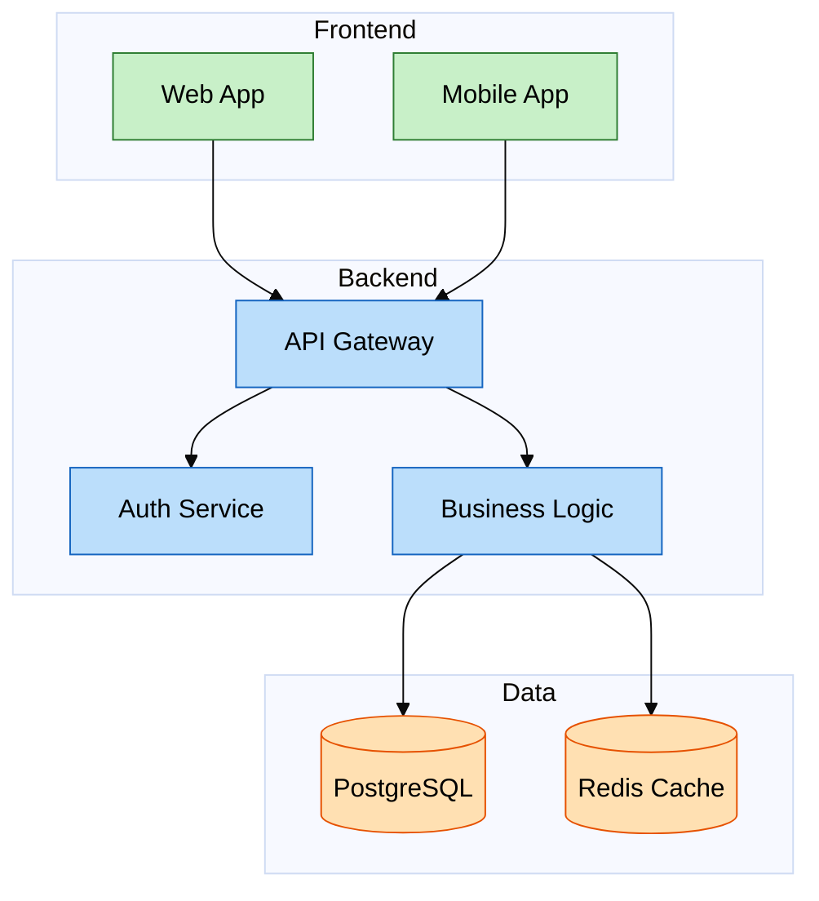

**Node shape quick reference:**
- `[Label]` — rectangle (process / component)
- `(Label)` — rounded rectangle (soft process)
- `([Label])` — stadium / pill (start/end)
- `[[Label]]` — subroutine box
- `[(Label)]` — cylindrical (database)
- `{Label}` — diamond (decision)
- `{{Label}}` — hexagon (preparation)
- `>Label]` — asymmetric (annotation)
- `((Label))` — circle (event / junction)

**Edge quick reference:**
- `A --> B` — solid arrow
- `A --- B` — solid line, no arrow
- `A -.-> B` — dashed arrow
- `A ==> B` — thick arrow
- `A --"label"--> B` — labelled solid arrow
- `A -.->|"label"| B` — labelled dashed arrow
- `A <--> B` — bidirectional
- `A ~~~ B` — invisible link (layout hint only)

---

## Pattern 2 — Flowchart: Flat Dependency / Component Graph (LR)

**Use when:** dependency map with no strict layer hierarchy; connections in multiple directions.

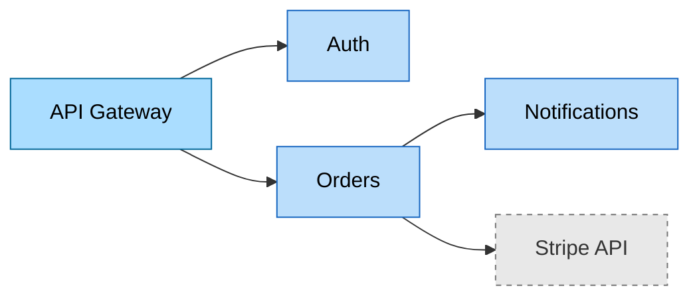

**Layout tip:** sibling subgraphs in `LR` can stack vertically.
See `layout-troubleshooting.md` → *LR subgraph stacking* if this happens.

---

## Pattern 3 — Flowchart: Decision Tree / Algorithm (TD)

**Use when:** branching logic, if/else, decision points.

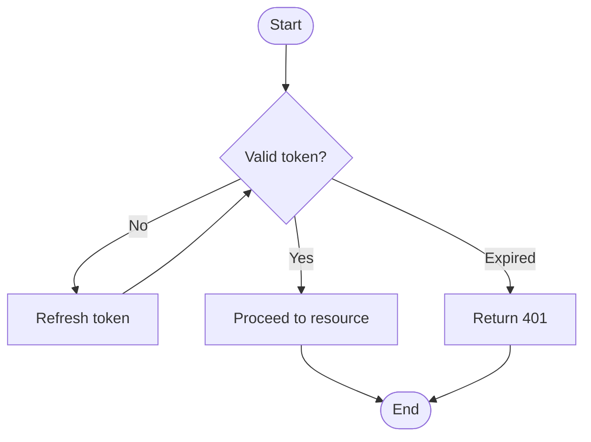

**Note:** always label diamond edges with the condition (`-- Yes -->`, `-- No -->`).

---

## Pattern 4 — Sequence Diagram

**Use when:** message flows between actors; request/response cycles; event ordering over time.

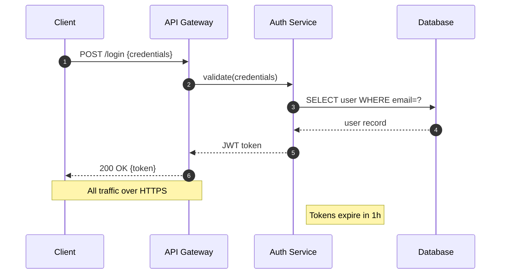

**Arrow types:**
- `->>` — solid synchronous call
- `-->>` — dashed return / async response
- `-x` — lost message (no response expected)
- `-)` — async fire-and-forget
- Bidirectional communication: represent as two messages (e.g. `A->>B: ...` and `B->>A: ...`).

**Modifiers:**
- `autonumber` — auto-number all messages
- `activate A` / `deactivate A` — show lifeline activation bars
- `loop [condition] ... end` — loop block
- `alt [condition] ... else ... end` — conditional block
- `par [label] ... and ... end` — parallel block
- `critical [label] ... option ... end` — critical region
- `break [condition] ... end` — break out of loop
- `rect rgb(200,220,255)` — coloured background block

---

## Pattern 5 — State Diagram

**Use when:** lifecycle of an entity; state machine; workflow with clear states and transitions.

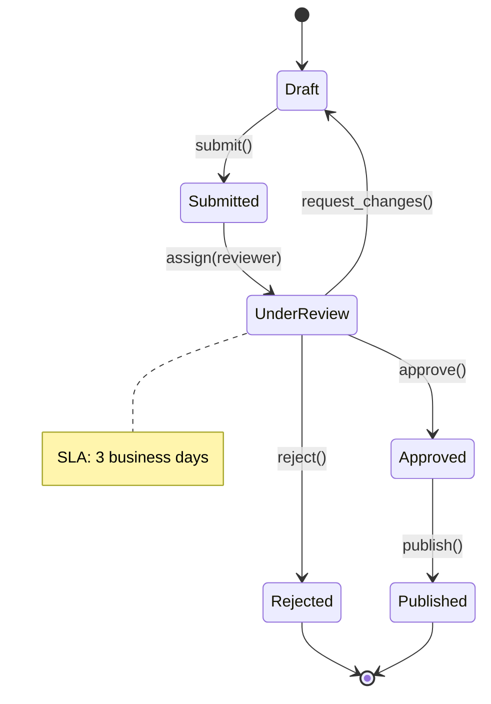

**Composite states (nested):**
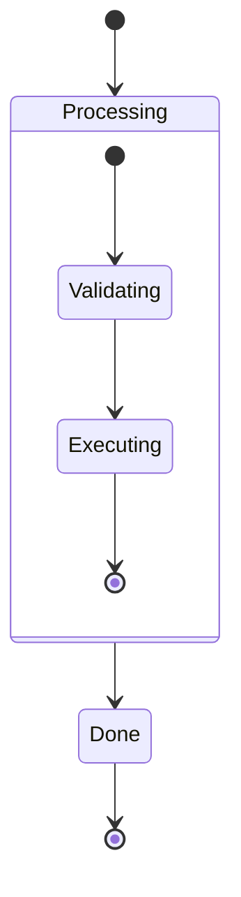

**Concurrent states:**
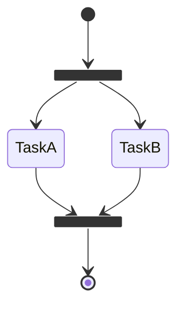

---

## Pattern 6 — Entity-Relationship Diagram

**Use when:** data model, database schema, domain entities with cardinalities.

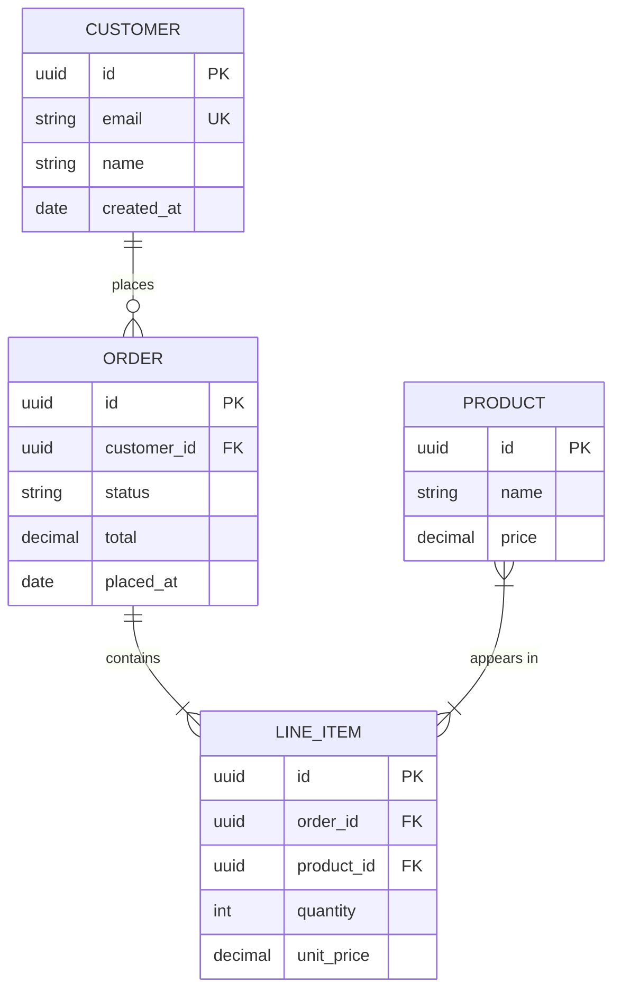

**Cardinality symbols** (mirror on the left side, e.g. `|o`/`o|`):
- `||` — exactly one
- `|o` / `o|` — zero or one
- `}o` / `o{` — zero or more
- `}|` / `|{` — one or more

**Relationship syntax:** `ENTITY_A cardinality--cardinality ENTITY_B : "verb label"`

---

## Pattern 7 — Class Diagram

**Use when:** OOP class structure, interfaces, inheritance hierarchies, design patterns.

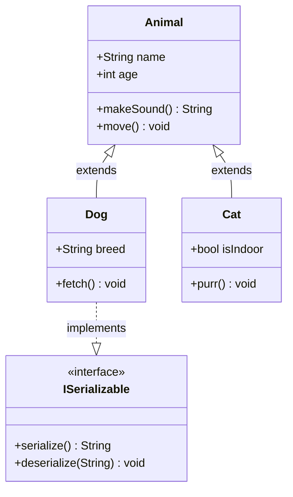

**Relationship types:**
- `<|--` — inheritance (extends)
- `..|>` — realisation (implements)
- `*--` — composition (owns)
- `o--` — aggregation (has)
- `-->` — association
- `..>` — dependency

**Visibility modifiers:** `+` public, `-` private, `#` protected, `~` package

**Classifiers:** `<<interface>>`, `<<abstract>>`, `<<enum>>`, `<<service>>`

**No semicolons in class bodies** — Mermaid does not use them.

---

## Pattern 8 — C4 Context Diagram

**Use when:** showing your system as a single box with its users and external dependencies.
*Still experimental in Mermaid — use VS Code or Mermaid Live; GitHub support is partial.*

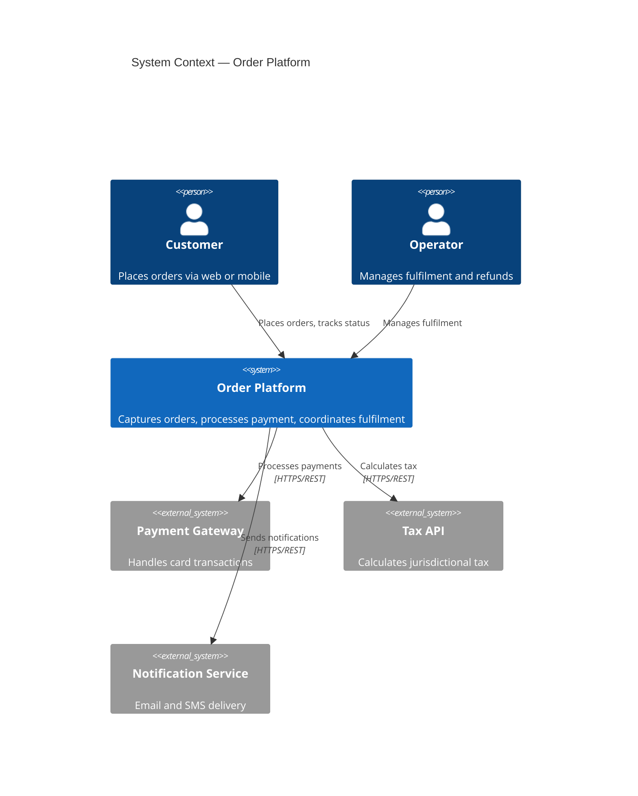

**C4 element types:**
- `Person(id, name, description)` — human user
- `System(id, name, description)` — your system (highlighted)
- `System_Ext(id, name, description)` — external system
- `Container(id, name, technology, description)` — app/DB inside your system
- `ContainerDb(id, name, technology, description)` — database container
- `Component(id, name, technology, description)` — component inside a container

**C4 relationship:** `Rel(from, to, "label")` or `Rel(from, to, "label", "protocol")`

---

## Pattern 9 — User Journey

**Use when:** mapping user steps with emotional sentiment scores.

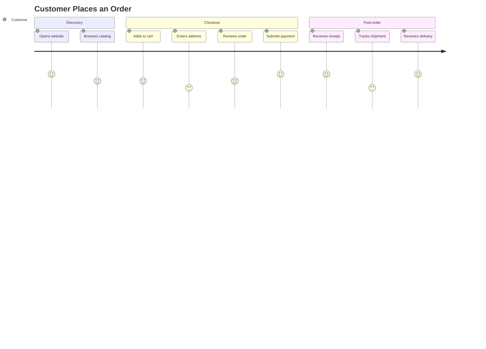

**Score:** 1 (terrible) to 5 (excellent). Actors listed after score with `:`.

---

## Pattern 10 — Gantt Chart

**Use when:** project timeline, sprint plan, release schedule with durations and dependencies.

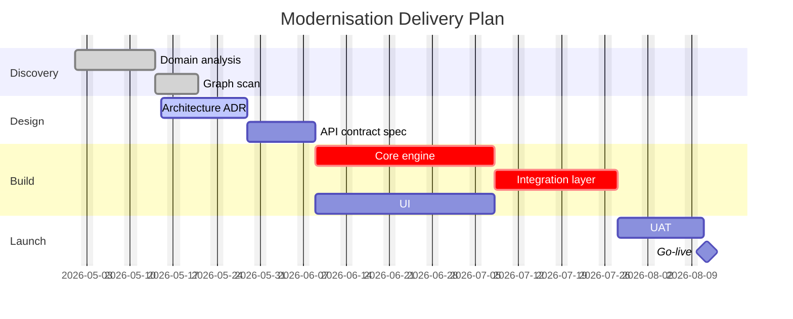

**Task modifiers:** `done`, `active`, `crit` (critical path), `milestone`
**Duration formats:** `7d`, `2w`, `after taskId` (dependency), `YYYY-MM-DD`

---

## Pattern 11 — Mindmap

**Use when:** hierarchical brainstorm, topic decomposition, knowledge map.
*Indentation defines hierarchy — consistent spacing is critical.*

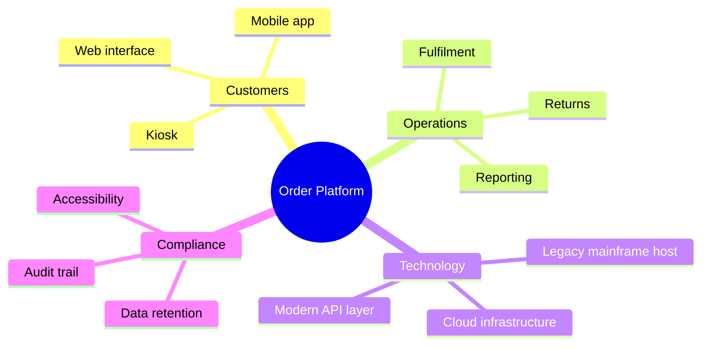

**Node shapes (mindmap only):**
- `((text))` — circle
- `(text)` — rounded rectangle
- `[text]` — square
- `{{text}}` — hexagon

---

## Pattern 12 — Timeline

**Use when:** chronological sequence of events; history; release history; milestones.

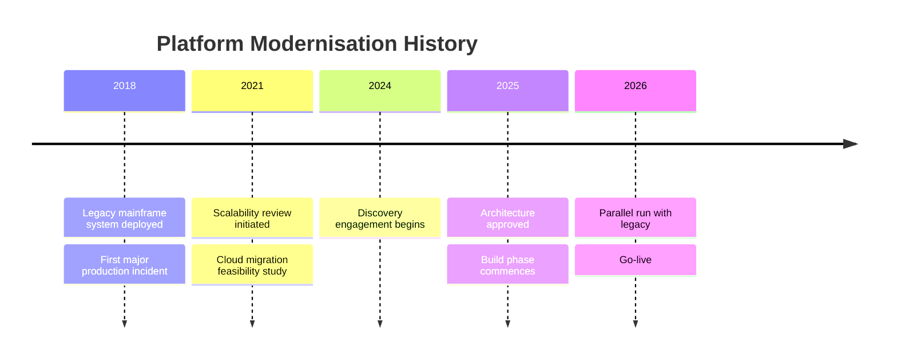

---

## Pattern 13 — Git Graph

**Use when:** showing git branching, merge strategy, release flow.

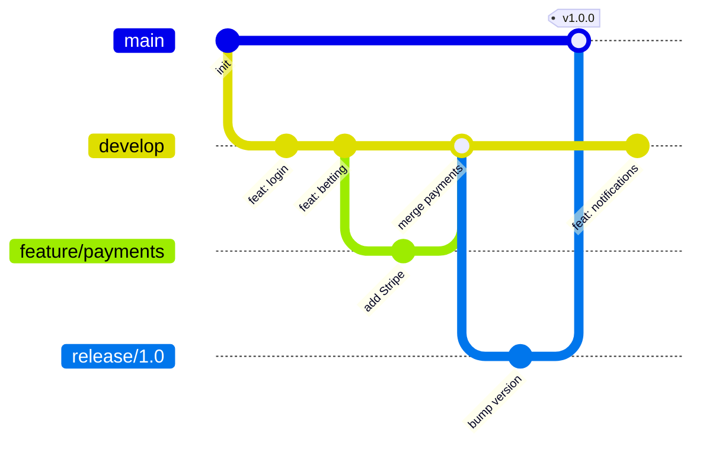

---

## Pattern 14 — Sankey Diagram

**Use when:** showing flow volumes between categories (budget, energy, traffic).
*Beta feature — not supported on GitHub markdown.*

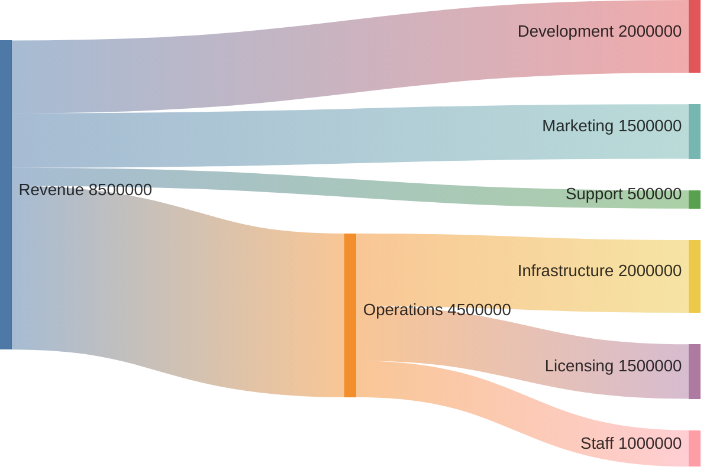

**Format:** `Source,Target,Value` — one flow per line, no header. `sankey-beta` still
works as an alias if a target renderer only recognises the older keyword.

---

## Pattern 15 — Quadrant Chart

**Use when:** 2×2 prioritisation matrix; impact vs effort; risk vs value.

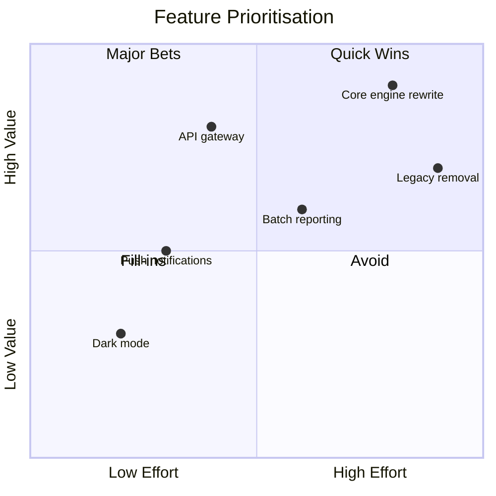

**Point format:** `Label: [x, y]` where x and y are 0.0–1.0.

---

## Pattern 16 — Pie Chart

**Use when:** showing parts of a whole as percentages.

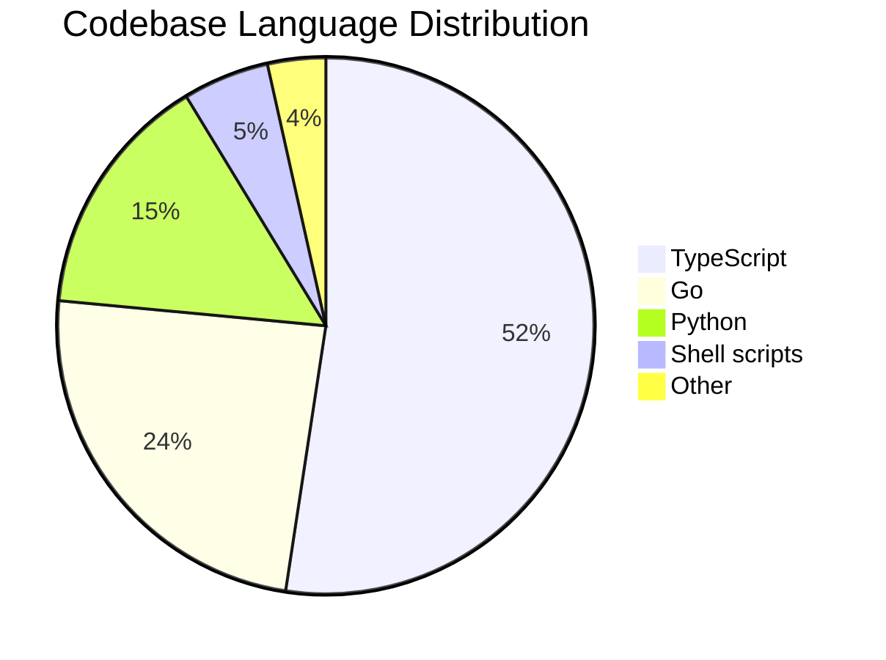

---

## Pattern 17 — Requirement Diagram

**Use when:** modelling formal requirements and how they trace to other requirements or
verifying elements (SysML v1.6-style). Good for regulated/compliance documentation.

```mermaid
requirementDiagram

requirement checkoutLatency {
    id: REQ-1
    text: Checkout must complete in under 2s at p95
    risk: high
    verifymethod: test
}

functionalRequirement retryOnFailure {
    id: REQ-2
    text: Payment step must retry once on transient failure
    risk: medium
    verifymethod: test
}

element loadTestSuite {
    type: simulation
}

loadTestSuite - verifies -> checkoutLatency
retryOnFailure - derives -> checkoutLatency
```

**Requirement types:** `requirement`, `functionalRequirement`, `performanceRequirement`,
`interfaceRequirement`, `physicalRequirement`, `designConstraint`

**Relationship verbs:** `contains`, `copies`, `derives`, `satisfies`, `verifies`,
`refines`, `traces` — syntax: `SOURCE - verb -> TARGET`

---

## Pattern 18 — XY Chart

**Use when:** plotting numeric series against categories directly in Mermaid — bar,
line, or both together. This is the one Mermaid type built for genuinely data-dense
output; still prefer a real charting library (see `dataviz` skill) once axes, legends,
or interactivity need to go beyond what a static SVG can show.

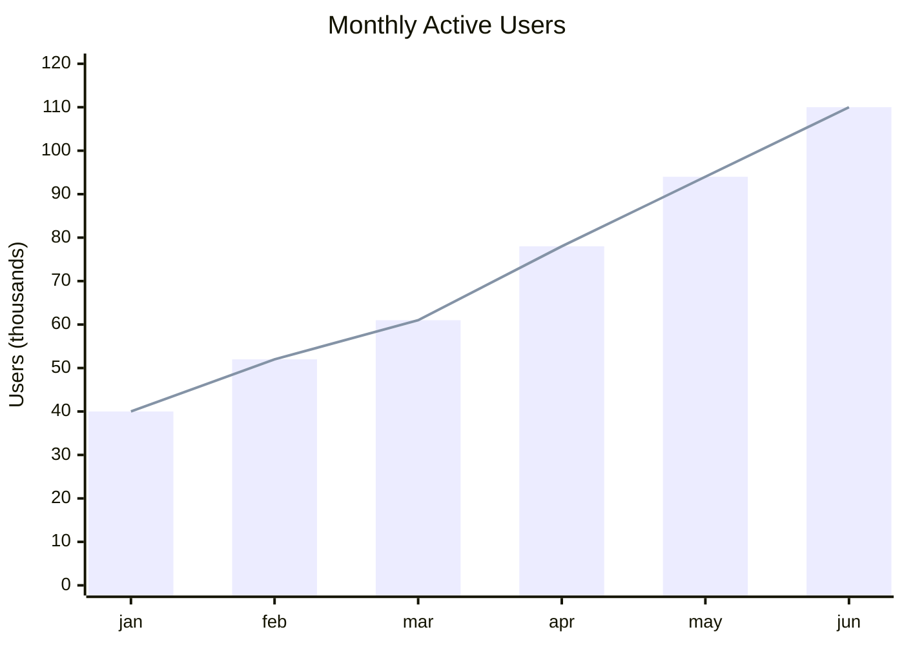

**Series types:** `bar [...]`, `line [...]` — combine both on the same axes for a
combo chart. `x-axis` accepts either a category list (`[a, b, c]`) or a numeric range
(`0 --> 10`). `xychart-beta` still works as an alias if a target renderer only
recognises the older keyword.

---

## Pattern 19 — Block Diagram

**Use when:** a flowchart's strict node/edge model is too rigid — free-form block
layout with explicit column counts, merged/spanning blocks, and mixed arrow directions.
Good for hardware/memory layout, wireframe-style boxes, or grouped component maps that
don't fit flowchart's edge-driven layout.

```mermaid
block
columns 3
  api["API Gateway"] auth["Auth Service"] db[("User DB")]
  space:3
  block:queue
    columns 1
    p1["orders.created"]
    p2["orders.shipped"]
  end
  api --> auth
  auth --> db
  api --> queue

  classDef svc fill:#bbdefb,stroke:#1565c0,color:#000
  class api,auth svc
```

**Key syntax:** `columns N` sets the grid width; `block:id ... end` groups a sub-block
(nest `columns` inside it independently — the group has no bracket-label shorthand of
its own, so give a labelled node inside if the group needs a visible title); `space` /
`space:N` leaves empty grid cells; blocks accept the same shape syntax as flowchart
nodes. `block-beta` still works as an alias if a target renderer only recognises the
older keyword.

---

## Pattern 20 — Kanban Board

**Use when:** showing a task board — backlog / in-progress / done — as a diagram inside
docs rather than linking out to the actual tracker.

```mermaid
kanban
  backlog[Backlog]
    task1[Design API contract]
    task2[Spike auth options]
  inProgress[In Progress]
    task3[Implement checkout endpoint]@{ assigned: 'maria' }
  done[Done]
    task4[Set up CI pipeline]
```

**Metadata per task:** `@{ assigned: 'name', ticket: 'JIRA-123', priority: 'High' }` —
optional, rendered as a small badge on the card.

---

## Pattern 21 — Architecture Diagram

**Use when:** showing cloud/CI-CD topology — services, storage, and groups with
labelled icons, closer to an actual infra diagram than a generic flowchart box.

```mermaid
architecture-beta
    group api(cloud)[API Platform]

    service gateway(internet)[API Gateway] in api
    service auth(server)[Auth Service] in api
    service db(database)[User DB] in api
    service cache(disk)[Redis Cache] in api

    gateway:B -- T:auth
    auth:B -- T:db
    auth:R -- L:cache
```

**Building blocks:** `group id(icon)[Label]` (optional `in parentId`),
`service id(icon)[Label]` (optional `in parentId`), edges as
`serviceA:SIDE -- SIDE:serviceB` where `SIDE` is `T`/`B`/`L`/`R`. Common icons:
`cloud`, `database`, `disk`, `server`, `internet`.

---

## Pattern 22 — Radar Chart

**Use when:** comparing several entities across the same set of dimensions at a
glance — skill matrices, capability scoring, before/after comparisons.

```mermaid
radar-beta
  title Team Skill Coverage
  axis frontend["Frontend"], backend["Backend"], infra["Infra"]
  axis testing["Testing"], security["Security"], docs["Docs"]
  curve current["Current"]{70, 85, 60, 50, 40, 55}
  curve target["Target"]{85, 85, 80, 75, 70, 75}

  max 100
  min 0
```

**Syntax:** one or more `axis id["Label"], ...` lines define the spokes (order matters,
all axes share one chart); `curve id["Label"]{v1, v2, ...}` supplies one value per axis
in declaration order; `max`/`min` set the shared scale.

---

## Pattern 23 — Treemap

**Use when:** parts-of-a-whole where the categories are hierarchical (nested), not
flat — `pie` handles flat proportions; treemap handles proportions-within-proportions.

```mermaid
treemap-beta
"Cloud Spend"
    "Compute"
        "EC2": 42000
        "Lambda": 8500
    "Storage"
        "S3": 12000
        "EBS": 6000
    "Networking"
        "Data transfer": 9000
```

**Format:** quoted string = a category (creates a nested box); `"Leaf": value` = a
sized leaf. Indentation defines nesting, same rule as mindmap.

---

## Pattern 24 — Packet Diagram

**Use when:** documenting a binary wire format or protocol header, bit-by-bit or
byte-by-byte.

```mermaid
---
title: "Custom Auth Token Header"
---
packet
0-7: "Version"
8-15: "Flags"
16-47: "Issued At (epoch)"
48-111: "Session ID"
112-127: "Checksum"
```

**Format:** `start-end: "Label"` (bit range, inclusive) or `bit: "Label"` for a single
bit. Ranges must be contiguous and cover the full declared width with no gaps.
`packet-beta` still works as an alias if a target renderer only recognises the older
keyword.

---

## Verification checklist (all types)

After drafting, run through this before outputting:

- [ ] Diagram type declaration matches intent
- [ ] Every element from the node/edge inventory is present
- [ ] No duplicate node IDs
- [ ] No reserved words used as IDs
- [ ] All special characters in labels are quoted
- [ ] Multi-line labels use `<br>`, not `\n`
- [ ] All brackets balanced
- [ ] Arrow syntax matches the diagram type
- [ ] Every `:::class` reference matches a defined `classDef` (order-independent; convention: at the bottom)
- [ ] `%%{init}%%` is on line 1 if used
- [ ] Direction matches visual intent
- [ ] Layout checked against `layout-troubleshooting.md`
