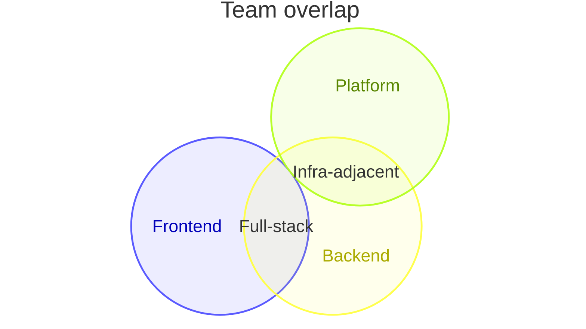
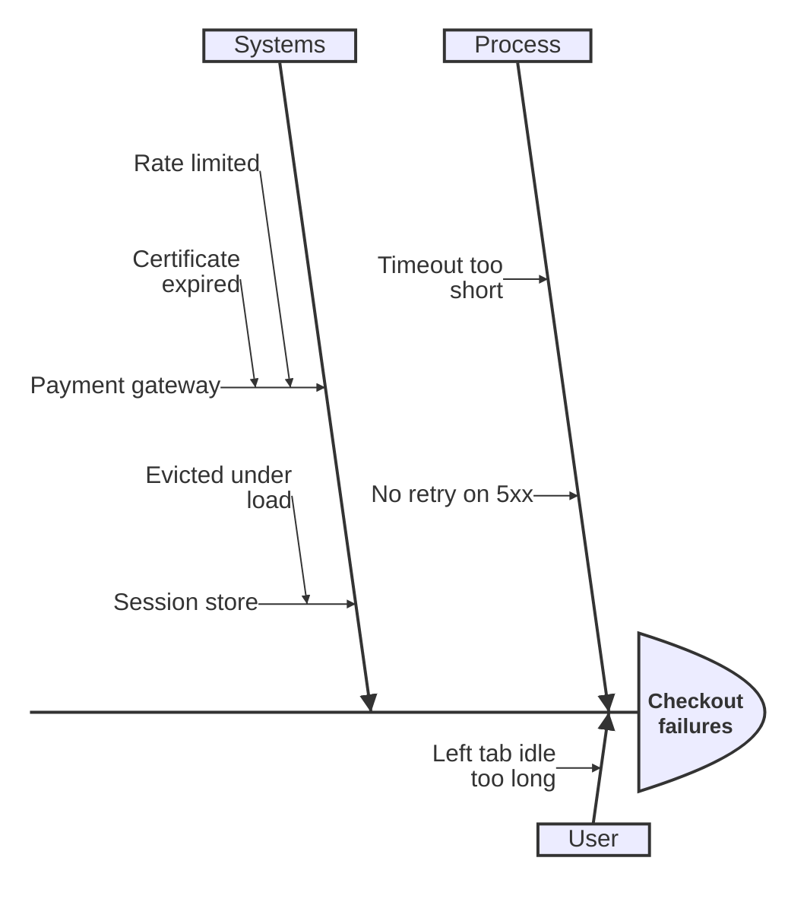
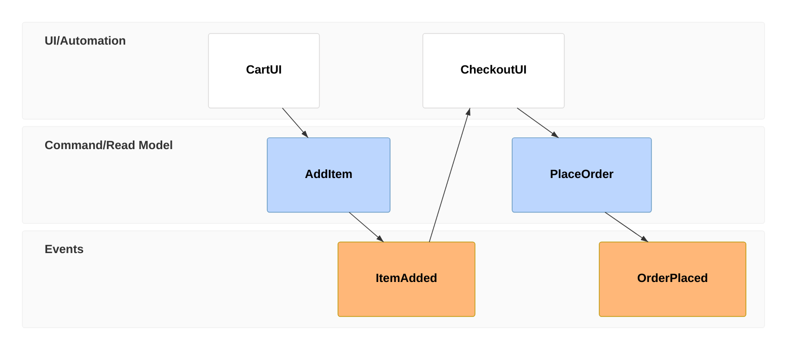
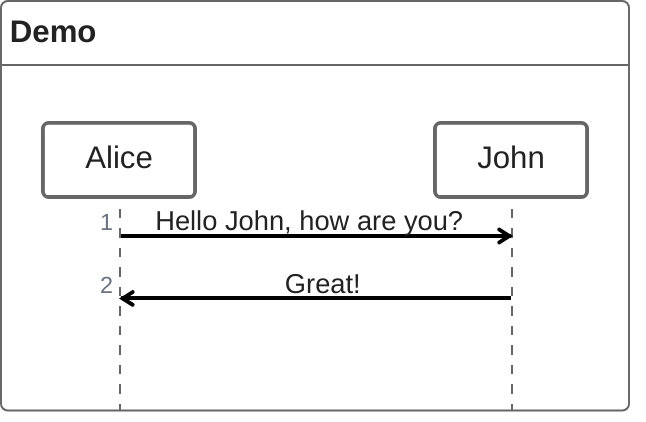

# Emerging Diagram Types

Niche or very recently shipped Mermaid diagram types. Each is confirmed present in the
current published Mermaid release (see `mermaid-version-compatibility.md` for exactly
which version introduced it and how well each renderer supports it yet) — but none of
these are candidates for the primary decision tree in `diagram-type-selector.md`
because the audience for them is narrow or the renderer support is still catching up.
Reach for one only when the user's intent specifically matches it, and pair it with the
renderer caution from `mermaid-version-compatibility.md`.

---

## Venn Diagram (`venn-beta`)

**Use when:** showing overlap between sets — shared responsibilities, feature overlap,
audience segmentation.



`set` declares a circle; `union A,B["label"]` labels the overlapping region between two
or more sets.

---

## Ishikawa / Fishbone Diagram (`ishikawa-beta`)

**Use when:** root-cause analysis — categorising causes of a single effect (the classic
"6 Ms": Method, Machine, Material, Man, Measurement, Environment).



First line (unindented) is the effect being analysed; top-level indents are cause
categories; deeper indents are specific causes.

---

## Wardley Map (`wardley-beta`)

**Use when:** strategy / value-chain mapping — positioning components by visibility
(y-axis) against evolution maturity, genesis → commodity (x-axis).

```mermaid
wardley-beta
title Checkout Value Chain

anchor Customer [0.95, 0.85]
component Checkout UI [0.80, 0.65]
component Payment Processing [0.60, 0.45]
component Card Network [0.30, 0.25]

Customer -> Checkout UI
Checkout UI -> Payment Processing
Payment Processing -> Card Network

evolve Card Network 0.85

note "Card network is treated as a commodity utility" [0.35, 0.15]
```

Coordinates are `[visibility, maturity]`, both `0.0`–`1.0`. `evolve` marks a component's
target maturity for a "where this is heading" annotation.

---

## Cynefin Framework (`cynefin-beta`)

**Use when:** classifying a problem or incident by complexity domain — clear,
complicated, complex, chaotic, or confused — to decide response style (best practice
vs. expert analysis vs. experimentation vs. immediate action).

```mermaid
cynefin-beta
  title Incident Response
  complex
    "Investigate root cause"
    "Run chaos experiment"
  complicated
    "Analyze performance data"
    "Escalate to platform team"
  clear
    "Restart the service"
    "Apply the documented fix"
  chaotic
    "Page on-call immediately"
  confusion
    "Unknown failure mode — triage first"
```

---

## Swimlane Diagram (`swimlane-beta`)

**Use when:** a process crosses team/role boundaries and the lane assignment itself is
the point — distinct from a flowchart using subgraphs as informal lanes (Pattern 1 in
`diagram-patterns.md`), this is a dedicated diagram type with its own layered
orthogonal layout algorithm, generally cleaner for cross-functional handoff diagrams.

```mermaid
swimlane-beta LR
  subgraph Customer
    request[Request refund]
    receive[Receive confirmation]
  end
  subgraph Support
    triage[Triage request]
    approve[Approve refund]
  end
  subgraph Finance
    process[Process payment reversal]
  end

  request --> triage
  triage -->|Approved| approve
  approve --> process
  process --> receive
```

**If the target renderer is GitHub or an older tool**, use the flowchart+subgraph
pattern instead — `swimlane-beta` is one of the newest types (v11.16.0+) and is the
least likely of this file's entries to render outside VS Code's Mermaid Chart extension
or Mermaid Live today.

---

## Tree View (`treeView-beta`)

**Use when:** showing a file/directory structure or any strict hierarchy, rendered as
an indented tree rather than boxes-and-arrows.


Accepts literal box-drawing characters as input (as above) — paste a `tree`-command
output directly rather than hand-building indentation.

---

## Event Modeling (`eventmodeling`)

**Use when:** documenting a system as a timeline of UI steps, commands, and the events
they produce — event-sourcing / CQRS-style design.



`tf <step> <kind> <label>` — `kind` is `ui`, `cmd`, or `evt`; steps render left-to-right
in a swimlane-like timeline by kind.

---

## Railroad / Syntax Diagrams

**Use when:** documenting a formal grammar (a DSL, a config file format, a parser rule)
as a railroad/syntax diagram. Four input syntaxes share the same rendering:

| Keyword | Input format |
|---|---|
| `railroad-beta` | Mermaid's own intermediate representation |
| `railroad-ebnf-beta` | EBNF |
| `railroad-abnf-beta` | ABNF |
| `railroad-peg-beta` | PEG |

```mermaid
railroad-ebnf-beta
title "Identifier"

identifier = letter , { letter | digit | "_" } ;
```

Prefer whichever grammar notation the source-of-truth spec is already written in — no
need to transliterate EBNF into ABNF just to match a habit.

---

## ZenUML (`zenuml`)

**Not part of Mermaid core.** ZenUML is a separate npm package
(`@mermaid-js/mermaid-zenuml`) offering an alternative, more code-like syntax for
sequence diagrams. A host application must explicitly register it — GitHub, VS Code's
default preview, and Mermaid Live's default configuration do **not** have it registered.
Confirm the target actually has it wired up before drafting in this syntax; otherwise
use the standard `sequenceDiagram` pattern instead.



---

## Not yet released — do not draft

Two diagram types are documented on Mermaid's source repo ahead of their actual release
and are **absent from the current published package** (verified by grepping the
minified bundle — see `mermaid-version-compatibility.md`). No renderer anywhere can
display them today:

- **Agent Flow** (`agentflow-beta`) — a diagram type for AI agent workflows (steps
  tagged as `input`, `task`, `tool`, `decision`, grouped into named `flow` blocks).
  Substitute `flowchart TD` (or `sequenceDiagram` if timing/handoffs matter more) today,
  and mention the dedicated type is coming.
- **Use Case Diagram** (`usecase-beta`) — UML-style actors + system boundary + use
  cases. Substitute `flowchart LR` with actor-shaped nodes and a labelled subgraph as
  the boundary, or `classDiagram` if UML notation fidelity matters more.

If a user explicitly names either type, tell them it isn't released yet rather than
guessing at syntax that won't render.
