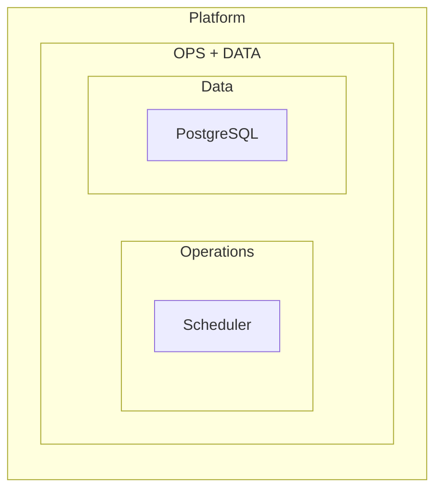
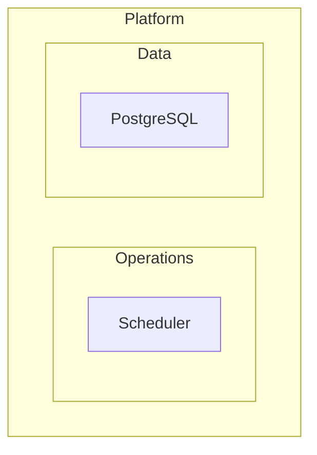
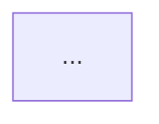

# Layout Troubleshooting

---

## 1. LR subgraph stacking (most common layout bug)

**Symptom:** Sibling subgraphs that should render side-by-side in `direction LR`
stack vertically instead.

**Root cause:** dagre (the default layout engine) ignores `direction LR` hints on
subgraphs when nodes inside those subgraphs have edges crossing to sibling subgraphs or
the parent. The outer graph's direction wins.

**Fix order — try cheapest first:**

### Fix 1 — Invisible link (cheap, non-destructive)
Add a `~~~` link between existing nodes (one in each subgraph) to hint dagre about left-right ordering:
~~~
opsGateway ~~~ dataGateway
~~~
Add it after all real edges. The link itself is invisible, but the node IDs must already exist (otherwise Mermaid will create and render new nodes).

### Fix 2 — Break back-edges / cycles (medium)
If `SubA` and `SubB` have edges in both directions, merge into one bidirectional:
```
A <-.-> B
```
instead of:
```
A --> B
B --> A
```
Cycles between siblings confuse dagre's topological sort.

### Fix 3 — Flatten nesting (most decisive lever)
Remove any intermediate **wrapper subgraph** so the offending subgraphs are
direct children of the same parent. One less container for dagre to fight.

**Before (stacks vertically):**


**After (renders side-by-side):**


> **Observed:** sibling subgraphs `OPS` and `DATA` wrapped in `OPS_DATA_ROW` stacked vertically despite `direction LR`.
> Removing the `OPS_DATA_ROW` wrapper was the only fix that stuck.

### Fix 4 — Reorder declarations (last resort)
Declare the subgraph you want on the left *first* in the source. dagre uses
declaration order as a tiebreaker when layout constraints are equal.

---

## 2. Subgraph `direction` hint ignored

**Rule:** If *any* node inside a subgraph is connected to a node *outside* that
subgraph, the subgraph's `direction` statement is ignored. The parent graph's
direction applies to everything.

**Workaround:** Accept the parent direction, or restructure so all external edges
attach to a "gateway" node at the subgraph boundary rather than internal nodes.

---

## 3. Large diagrams — node overlap and crowding

For diagrams with 15+ nodes, switch to the **ELK layout engine** via an `%%{init}%%`
directive:



ELK benefits:
- Significantly reduces node overlap
- Better handles wide, flat graphs
- More consistent spacing with many parallel edges

ELK caveats:
- Not supported on GitHub markdown (falls back to dagre silently)
- Supported: VS Code Mermaid extension, Mermaid Live Editor, draw.io, Confluence (newer)
- Adds rendering time for very large graphs (> 100 nodes)

---

## 4. TB layout producing excessively wide output

Switch orientation or group dense clusters:
- Switch to `flowchart LR` and use one subgraph per conceptual row
- Add `direction TB` overrides on individual dense subgraphs to compress them vertically

---

## 5. Syntax error catalogue

| Symptom | Most likely cause | Fix |
|---|---|---|
| `Parse error` on a node line | Special character in unquoted label | Wrap label: `["API Gateway (v2)"]` |
| Diagram renders partially, then cuts off | Unclosed bracket in a label | Count `[` vs `]`, `(` vs `)`, `{` vs `}` |
| `Parse error` on edge line | Reserved word in node ID | Rename: `end` → `endNode`, `class` → `cls` |
| Class diagram semicolon error | Stray `;` after attribute or method | Remove all semicolons from `classDiagram` |
| Sequence diagram renders dashed where solid expected | `-->` used instead of `->>` | `-->` = dashed async; `->>` = solid sync |
| Duplicate node renders as one | Two nodes share the same ID | Rename one; IDs must be unique per diagram |
| `%%{init}%%` ignored | Placed after diagram type declaration | Move to line 1 |
| `classDef` colour not applied | `:::className` doesn't match a defined `classDef` (typo), or `themeVariables` override wins | Match names exactly; `classDef` order doesn't matter (bottom is fine); don't mix `themeVariables` colours with `classDef` |
| Subgraph label missing | Quote missing around multi-word label | `subgraph ID["Multi Word Label"]` |
| `style` not applying | Using `style nodeId fill:...` — fragile by ID | Use `classDef` + `:::className` instead |
| Invisible link `~~~` causing error | Wrong number of tildes | Must be exactly three: `~~~` |
| `gitGraph` branch error | Checking out non-existent branch | Always `branch X` before `checkout X` |
| `erDiagram` cardinality error | Relationship line not using `--` separator | Correct: `A ||--o{ B : "label"` |

---

## 6. Labels — quoting rules

**Always quote** if the label contains any of:

```
( )  [ ]  { }  :  /  @  #  >  <  &  "  '
```

Correct:
```
A["API Gateway (v2)"] --> B["Auth: OAuth 2.0"]
C["Score > 90%"] --> D["Notify via email/SMS"]
```

Wrong (parse error):
```
A[API Gateway (v2)] --> B[Auth: OAuth 2.0]
```

For labels that contain double quotes, use HTML entities: `&quot;`.

---

## 7. Reserved words that break node IDs

Never use these as bare node IDs:

```
end       class      classDef   direction
subgraph  style      graph      flowchart
sequenceDiagram      stateDiagram  erDiagram
call      click      linkStyle  note
```

Safe alternatives: `endNode`, `cls`, `styleNode`, `graphNode`, `callStep`, `noteBox`

---

## 8. Sequence diagram — common structural mistakes

- **`activate`/`deactivate` mismatch:** every `activate A` needs a matching `deactivate A`
- **`loop`/`alt`/`par`/`break` not closed:** every block needs `end`
- **Actor declared mid-diagram:** declare all `participant` lines at the top
- **`Note over A,B`** — comma syntax, no spaces around it — `Note over A, B` also works
- **`rect`** — must be closed with `end`; cannot be nested

---

## 9. Splitting large diagrams

When a diagram grows beyond ~40 nodes:
1. Identify conceptual clusters (bounded contexts, layers, subsystems)
2. Create one diagram per cluster
3. Add a "context" diagram (flowchart LR or C4Context) that shows how clusters connect
4. Link diagrams in the document with prose: *"See [Container Diagram] for internal detail"*

Never try to show everything in one canvas — the diagram becomes unreadable and dagre
layout quality degrades sharply above 50 nodes.
