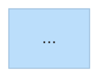

# Style Palette

---

## Core rule

Use `classDef` for **all** colour and style. Never use `style nodeId fill:...` inline —
it is fragile (breaks when node ID changes) and harder to maintain.

Define all `classDef` statements at the **bottom** of the diagram, after all nodes
and edges. Apply with `:::className` suffix on the node declaration.

```mermaid
A["Node"]:::myClass
...
classDef myClass fill:#bbdefb,stroke:#1565c0,color:#000
```

Limit to **≤ 5 distinct classes** per diagram. More creates visual noise.

---

## Palette 1 — Risk / Severity (universal)

Use on any diagram type to indicate risk, priority, or alert level.

```
classDef critical  fill:#f88,stroke:#900,color:#000
classDef major     fill:#fb8,stroke:#940,color:#000
classDef moderate  fill:#ffd,stroke:#aa0,color:#000
classDef minor     fill:#dfd,stroke:#080,color:#000
classDef neutral   fill:#eee,stroke:#999,color:#000
```

| Class | Colour | Use for |
|---|---|---|
| `critical` | Red | Blocking / P0 / system-down |
| `major` | Orange | High-risk / P1 / degraded |
| `moderate` | Yellow | Medium-risk / P2 |
| `minor` | Green | Low-risk / healthy |
| `neutral` | Grey | Inactive / informational |

---

## Palette 2 — Architecture Layers

Use on layered architecture flowcharts.

```
classDef frontend  fill:#c8f0c8,stroke:#2e7d32,color:#000
classDef backend   fill:#bbdefb,stroke:#1565c0,color:#000
classDef data      fill:#ffe0b2,stroke:#e65100,color:#000
classDef infra     fill:#e1bee7,stroke:#6a1b9a,color:#000
classDef external  fill:#e8e8e8,stroke:#757575,color:#333,stroke-dasharray:4 4
classDef deferred  fill:#f5f5f5,stroke:#bbb,color:#aaa,stroke-dasharray:2 2
```

| Class | Colour | Layer |
|---|---|---|
| `frontend` | Green | User-facing surfaces |
| `backend` | Blue | APIs, business logic |
| `data` | Orange | Databases, caches |
| `infra` | Purple | Cloud, hosting, CDN |
| `external` | Grey dashed | Third-party systems |
| `deferred` | Light grey dashed | Out-of-scope / future |

---

## Palette 3 — Status / Phase

Use on state diagrams, roadmaps, task boards.

```
classDef done     fill:#c8f0c8,stroke:#2e7d32,color:#000
classDef active   fill:#bbdefb,stroke:#1565c0,color:#000
classDef pending  fill:#fff9c4,stroke:#f9a825,color:#000
classDef blocked  fill:#ffccbc,stroke:#bf360c,color:#000
classDef skipped  fill:#f5f5f5,stroke:#bbb,color:#aaa,stroke-dasharray:2 2
```

---

## Palette 4 — Highlight + Context

Use when one or two nodes need to stand out (entry points, focal systems, key decisions).

```
classDef highlight  fill:#adf,stroke:#069,color:#000
classDef dim        fill:#f5f5f5,stroke:#ddd,color:#aaa
classDef warning    fill:#fff3e0,stroke:#e65100,color:#000
classDef info       fill:#e3f2fd,stroke:#1565c0,color:#000
```

---

## Palette 5 — Dark mode safe

Use when the target renderer is a dark-themed VS Code or Mermaid Live dark theme.
High-contrast borders, slightly saturated fills that stay readable on dark backgrounds.

```
classDef critical  fill:#c62828,stroke:#ef9a9a,color:#fff
classDef major     fill:#e65100,stroke:#ffcc80,color:#fff
classDef moderate  fill:#f57f17,stroke:#fff176,color:#000
classDef minor     fill:#1b5e20,stroke:#a5d6a7,color:#fff
classDef neutral   fill:#37474f,stroke:#90a4ae,color:#fff
classDef highlight fill:#0d47a1,stroke:#90caf9,color:#fff
classDef external  fill:#212121,stroke:#757575,color:#bbb,stroke-dasharray:4 4
```

---

## Theming via `%%{init}%%`

Set a base theme before the diagram declaration (line 1):



**Available themes:** `default`, `base`, `dark`, `forest`, `neutral`

| Theme | Best for |
|---|---|
| `base` | Maximum `classDef` control — overrides are most reliable |
| `default` | Standard Mermaid look; good for GitHub |
| `dark` | Dark-background presentations; reverse on light screens |
| `forest` | Green-toned; readable in documentation sites |
| `neutral` | Greyscale; print-safe |

**Rule:** do not mix `%%{init}%%` theme variables with `classDef` colour overrides.
Pick one styling approach per diagram. `classDef` over `themeVariables` for precision;
`themeVariables` for a quick whole-diagram tone shift.

---

## Edge styling

Prefer avoiding edge-specific colour — use node `classDef` to signal meaning instead.
Edge styling by index is fragile: the index shifts every time you add or reorder edges.

If you must style a specific edge:

```
flowchart LR
    A --> B
    A --> C
    linkStyle 0 stroke:#f00,stroke-width:2px
```

`linkStyle 0` targets the first edge declared. Fragile — document the index explicitly.

For sequence diagrams, note blocks (`Note over A,B`) are more robust than edge colouring.

---

## Shape + style combinations for common node types

```
classDef database    fill:#ffe0b2,stroke:#e65100,color:#000
classDef queue       fill:#f3e5f5,stroke:#6a1b9a,color:#000
classDef service     fill:#bbdefb,stroke:#1565c0,color:#000
classDef gateway     fill:#adf,stroke:#069,color:#000
classDef user        fill:#c8f0c8,stroke:#2e7d32,color:#000
classDef decision    fill:#fff9c4,stroke:#f9a825,color:#000
```

Apply with matching shape:

```
db[("Orders DB")]:::database
queue{{"Event Queue"}}:::queue
svc["Payment Service"]:::service
gw["API Gateway"]:::gateway
user(("User")):::user
dec{Authorised?}:::decision
```
